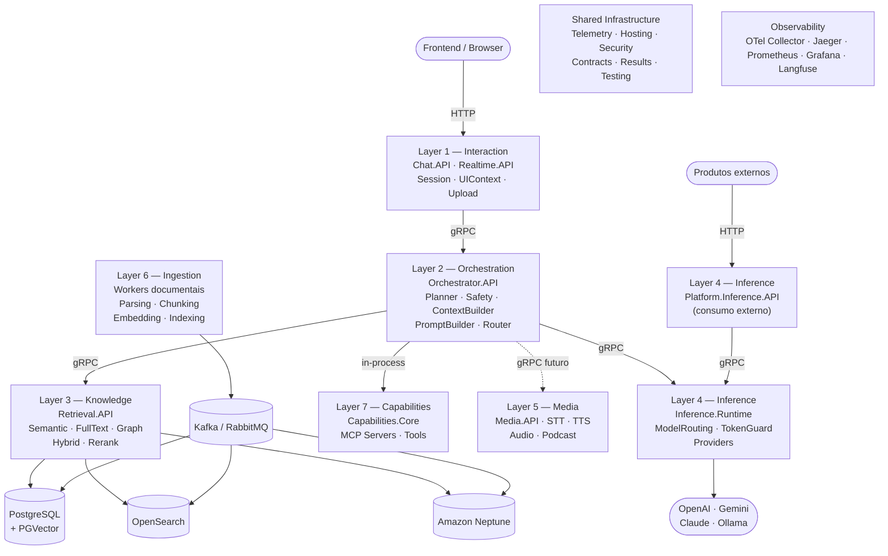
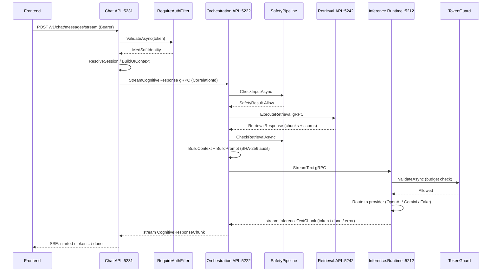

# MEDRobot Platform — Architecture Guide

**Versão:** 1.0 — Julho 2026  
**Propósito:** Guia oficial de engenharia. Serve como referência para entender este repositório e como modelo para novos projetos.

---

## Índice

1. [Arquitetura Geral](#1-arquitetura-geral)
2. [Estrutura de Pastas](#2-estrutura-de-pastas)
3. [Padrões de Código — Nomenclaturas](#3-padrões-de-código--nomenclaturas)
4. [Convenções de Código](#4-convenções-de-código)
5. [Comunicação entre Serviços](#5-comunicação-entre-serviços)
6. [Persistência](#6-persistência)
7. [Dependency Injection](#7-dependency-injection)
8. [Configuração da Aplicação](#8-configuração-da-aplicação)
9. [Logging](#9-logging)
10. [Observabilidade](#10-observabilidade)
11. [Tratamento de Erros](#11-tratamento-de-erros)
12. [Segurança](#12-segurança)
13. [Validações](#13-validações)
14. [Testes](#14-testes)
15. [Performance](#15-performance)
16. [Boas Práticas](#16-boas-práticas)
17. [Anti-patterns Evitados](#17-anti-patterns-evitados)
18. [Checklist para Novos Projetos](#18-checklist-para-novos-projetos)
19. [Templates Reutilizáveis](#19-templates-reutilizáveis)
20. [Guia de Desenvolvimento](#20-guia-de-desenvolvimento)
21. [Débitos Técnicos e Oportunidades de Padronização](#21-débitos-técnicos-e-oportunidades-de-padronização)

---

## 1. Arquitetura Geral

### 1.1 Estilo Arquitetural

O MEDRobot combina três abordagens complementares:

- **DDD (Domain-Driven Design)**: bounded contexts com responsabilidades e autonomias claras.
- **Modular Monorepo**: repositório único com solutions independentes por camada — não é um monólito.
- **AI-Native Platform Design**: IA não é um add-on, é infraestrutura central. Cada camada foi desenhada para o pipeline cognitivo.

Não é Clean Architecture clássica (sem Use Cases explícitos, sem Application Layer separada). O código de domínio vive dentro do bounded context como class libraries coesas, e as APIs são finas camadas de entrada/saída.

### 1.2 Camadas e Responsabilidades



| Camada | Diretório | Tecnologia de exposição | Responsabilidade |
|---|---|---|---|
| Interaction | `interaction/` | HTTP (Minimal API) | Entrada do usuário, sessão, UIContext, SSE streaming |
| Orchestration | `orchestration/` | gRPC | Planejamento cognitivo, Safety, Prompt Governance, roteamento |
| Knowledge | `knowledge/` | gRPC | Retrieval híbrido (semantic + fulltext + graph + rerank) |
| Inference | `inference/` | gRPC interno + HTTP externo | Execução de modelos, roteamento de providers, TokenGuard |
| Media | `media/` | gRPC (futuro) | Áudio, podcast, speech-to-text, text-to-speech |
| Ingestion | `ingestion/` | Workers assíncronos | Pipeline documental, chunking, embedding, indexação |
| Capabilities | `capabilities/` | In-process | MCP servers, tool adapters, integrações cognitivas |
| Observability | (configs) | OTel | Tracing, métricas, logs estruturados, AI observability |
| Shared | `shared/` | NuGet interno | Infraestrutura técnica: telemetry, hosting, security, contracts |

### 1.3 Fluxo Completo de uma Requisição (Chat Textual)



### 1.4 Comunicação entre Camadas

| Tipo | Tecnologia | Quando usar |
|---|---|---|
| Frontend → API | HTTP | Toda borda externa (browser, mobile) |
| Serviço → Serviço | gRPC | Toda comunicação interna entre serviços |
| Assíncrono | Kafka / RabbitMQ | Pipelines de ingestão documental |
| In-process | Chamada direta de interface | Capabilities consumidas pelo Orchestrator |

### 1.5 Dependências Permitidas

```
interaction/ → shared/
orchestration/ → shared/, capabilities/
knowledge/ → shared/
inference/ → shared/
capabilities/ → shared/
[qualquer camada] → [contracts da camada alvo via .proto]
```

**Nunca:**
- Referências cruzadas entre bounded contexts
- Domínio médico ou lógica cognitiva em `shared/`
- LLM providers chamados fora da Inference layer

### 1.6 Inversão de Dependência

Cada camada define suas próprias interfaces dentro do bounded context. A Hosting layer registra as implementações concretas. Não há um projeto de Abstractions cross-layer — cada contexto é soberano.

```csharp
// knowledge/MEDRobot.Knowledge.SemanticSearch/IKnowledgeChunkRepository.cs
public interface IKnowledgeChunkRepository { ... }

// knowledge/MEDRobot.Knowledge.Hosting/ServiceCollectionExtensions.cs
services.AddSingleton<IKnowledgeChunkRepository, PostgreSqlKnowledgeChunkRepository>();
```

---

## 2. Estrutura de Pastas

### 2.1 Layout do Repositório

```
medrobot-platform/
├── interaction/                  ← bounded context: Interaction
│   ├── MEDRobot.Interaction.sln
│   ├── MEDRobot.Interaction.Chat.API/
│   ├── MEDRobot.Interaction.Chat.API.Tests/
│   ├── MEDRobot.Interaction.Hosting/      ← DI registrations
│   ├── MEDRobot.Interaction.Contracts/    ← HTTP contracts (records)
│   ├── MEDRobot.Interaction.Session/      ← domain library
│   ├── MEDRobot.Interaction.UIContext/    ← domain library
│   └── MEDRobot.Interaction.Upload/       ← domain library
│
├── orchestration/
│   ├── MEDRobot.Orchestration.sln
│   ├── MEDRobot.Orchestration.API/        ← gRPC host
│   ├── MEDRobot.Orchestration.Contracts/  ← .proto + generated
│   ├── MEDRobot.Orchestration.Hosting/    ← DI + gRPC clients
│   ├── MEDRobot.Orchestration.Planner/
│   ├── MEDRobot.Orchestration.Safety/
│   ├── MEDRobot.Orchestration.ContextBuilder/
│   ├── MEDRobot.Orchestration.PromptBuilder/
│   ├── MEDRobot.Orchestration.PromptGovernance/
│   └── MEDRobot.Orchestration.Router/
│
├── knowledge/
│   ├── MEDRobot.Knowledge.sln
│   ├── MEDRobot.Knowledge.Retrieval.API/  ← gRPC host
│   ├── MEDRobot.Knowledge.Contracts/      ← .proto + generated
│   ├── MEDRobot.Knowledge.Hosting/
│   ├── MEDRobot.Knowledge.SemanticSearch/
│   ├── MEDRobot.Knowledge.FullTextSearch/
│   ├── MEDRobot.Knowledge.GraphSearch/
│   ├── MEDRobot.Knowledge.HybridSearch/
│   ├── MEDRobot.Knowledge.Reranking/
│   └── MEDRobot.Knowledge.Embedding/
│
├── inference/
│   ├── MEDRobot.Inference.sln
│   ├── MEDRobot.Inference.Contracts/      ← .proto + generated
│   ├── MEDRobot.Inference.Hosting/
│   ├── MEDRobot.Inference.Runtime/        ← gRPC host
│   ├── MEDRobot.Inference.ModelRouting/
│   ├── MEDRobot.Inference.TokenGuard/
│   ├── MEDRobot.Inference.Providers.Abstractions/
│   ├── MEDRobot.Inference.Providers.Fake/
│   ├── MEDRobot.Inference.Providers.OpenAI/
│   └── MEDRobot.Inference.Providers.Claude/
│
├── shared/
│   ├── MEDRobot.Shared.sln
│   ├── MEDRobot.Shared.Hosting/      ← AddMEDRobotApiDefaults
│   ├── MEDRobot.Shared.Telemetry/    ← PlatformTelemetry, ActivitySource, Meter
│   ├── MEDRobot.Shared.Security/     ← JWT, auth filters, tenant context
│   ├── MEDRobot.Shared.Contracts/    ← TechnicalEnvelope, CorrelationContext
│   ├── MEDRobot.Shared.Abstractions/ ← interfaces técnicas básicas
│   ├── MEDRobot.Shared.Results/      ← OperationResult<T>
│   ├── MEDRobot.Shared.Presentations/← ProblemDetails, error mapping
│   ├── MEDRobot.Shared.Messaging/    ← abstrações para mensageria
│   └── MEDRobot.Shared.Testing/      ← TestClock, SequentialIdGenerator
│
├── infra/local/                  ← Docker Compose, Dockerfiles, SQL init
├── docs/                         ← ADRs, runbooks, onboarding
├── tools/smoke/                  ← Scripts bash de smoke test
└── admin/serenity/               ← Frontend admin (Vite + React)
```

### 2.2 Quando criar um novo projeto dentro de um bounded context

| Situação | Ação |
|---|---|
| Nova lógica de domínio isolada | Novo `MEDRobot.<Context>.<Module>/` (class library) |
| Novo ponto de entrada HTTP externo | Novo `MEDRobot.<Context>.API/` + `*.Contracts/` |
| Nova API interna (gRPC) | Novo `MEDRobot.<Context>.<Module>.API/` + `*.Contracts/` (com .proto) |
| Novos registros de DI | Adicionar no `MEDRobot.<Context>.Hosting/` existente |
| Testes de um módulo | Novo `MEDRobot.<Context>.<Module>.Tests/` irmão |

**Não criar** um projeto separado para cada classe. Módulos relacionados do mesmo contexto ficam no mesmo projeto.

### 2.3 Quando NÃO criar um novo projeto

- Não criar um projeto `MEDRobot.Shared.<Domain>` para domínio de negócio — vai para o bounded context correto.
- Não criar um projeto separado só para interfaces de um contexto — ficam dentro do próprio módulo.
- Não criar project references entre bounded contexts — use contratos via gRPC.

---

## 3. Padrões de Código — Nomenclaturas

### 3.1 Projetos e Namespaces

| Tipo | Padrão | Exemplo |
|---|---|---|
| API HTTP | `MEDRobot.<Context>.API` | `MEDRobot.Interaction.Chat.API` |
| API gRPC | `MEDRobot.<Context>.Contracts` | `MEDRobot.Orchestration.Contracts` |
| Library | `MEDRobot.<Context>.<Module>` | `MEDRobot.Knowledge.SemanticSearch` |
| Worker | `MEDRobot.<Capability>.Worker` | `MEDRobot.Ingestion.DocumentIngestion.Worker` |
| Testes | `MEDRobot.<Context>.<Module>.Tests` | `MEDRobot.Inference.TokenGuard.Tests` |

### 3.2 Classes e Tipos

| Tipo | Padrão | Exemplo |
|---|---|---|
| Service (classe de domínio) | `<Substantivo><Verbo>er` ou `<Adjective><Noun>` | `ProfessionalSafetyPipeline`, `ScoreMergingHybridSearchEngine` |
| Interface | `I` + nome do conceito | `ISafetyPipeline`, `IKnowledgeChunkRepository` |
| Options | `<Name>Options` com `const string SectionName` | `InferenceRuntimeOptions`, `KnowledgeRetrievalOptions` |
| Record (DTO/request/response) | substantivo descritivo | `CognitiveRequest`, `RetrievalResponse`, `SafetyResult` |
| Value Object | `sealed record <Name>(Type Value)` | `PromptId`, `PromptVersion`, `CorrelationContext` |
| Fake / Test Double | `Fake<Interface>` | `FakeTextInferenceProvider`, `FakeMedSoftAuthValidator` |
| gRPC Service | `<Name>GrpcService` | `OrchestratorGrpcService`, `InferenceRuntimeGrpcService` |
| Middleware | `<Name>Middleware` | `GlobalErrorHandlerMiddleware`, `CorrelationMiddleware` |
| Endpoint Filter | `<Name>Filter` | `RequireAuthFilter` |
| Health Check | `<Name>HealthCheck` | `PgVectorHealthCheck` |
| Validator | `<Name>Validator` | `HostingOptionsValidator`, `JwtValidationOptionsValidator` |
| Enum | PascalCase, singular | `SafetyDecision`, `GroundingConfidence`, `AuthValidatorMode` |
| Constants | `static class <Name>` + PascalCase members | `TelemetryTagNames.CorrelationId`, `InferenceErrorCodes.BudgetExceeded` |
| Exception | `<Condition>Exception` extends `ControlledFailureException` | `InferenceBudgetException`, `UpstreamServiceException` |
| Mapper (estático) | `<Name>Mapper` | `ApiErrorCodeMapper` |

### 3.3 Variáveis e Parâmetros

| Tipo | Padrão | Exemplo |
|---|---|---|
| Campos de instância | camelCase sem `_` prefixo | `this.logger`, `this.options` |
| Campos `static readonly` | camelCase na instância, mas `static readonly` | `private static readonly Regex VariableRegex = ...` |
| Parâmetros de método | camelCase | `correlationId`, `cancellationToken` |
| Variáveis locais | camelCase com `var` quando tipo é óbvio | `var stopwatch = Stopwatch.StartNew()` |
| CancellationToken | sempre o último parâmetro | `(TokenBudgetRequest request, CancellationToken cancellationToken)` |
| Booleanos | Is/Has/Can prefix no conceito | `IsAllowed`, `HasPermission`, `IsFinal` |
| Coleções | plural do tipo | `semanticResults`, `violations`, `templateIds` |

### 3.4 Testes

| Tipo | Padrão | Exemplo |
|---|---|---|
| Classe de teste | `<SubjectUnderTest>Tests` sealed | `ProfessionalSafetyPipelineTests` |
| Método de teste | `<Method>_<Condition>_<ExpectedOutcome>` | `CheckInputAsync_WhenPrescriptionRequest_Blocks` |
| Fakes inline | `sealed class Fake<Name>` dentro do arquivo de teste | `FakeSessionManager`, `CapturingOrchestratorClient` |

---

## 4. Convenções de Código

### 4.1 Classes e Tipos

**Toda classe de serviço ou infraestrutura é `sealed`.** Não se usa herança para extensão — usa-se interfaces e composição.

```csharp
// Correto
public sealed class ProfessionalSafetyPipeline : ISafetyPipeline { ... }

// Correto — value objects e DTOs como records
public sealed record PromptId(string Value)
{
    public static PromptId Create(string value) => new(value.Trim());
}
```

**Records** para todo dado imutável: requests, responses, results, value objects, contextos.  
**Classes** para serviços, infraestrutura, middlewares.

### 4.2 Async/Await

`async Task<T>` em qualquer método com I/O. **Não existe `ConfigureAwait(false)` no codebase** — a decisão é consciente: ASP.NET Core não tem `SynchronizationContext` e essa supressão seria ruído desnecessário.

Para operações síncronas curtas, preferir `Task.FromResult(...)` ao invés de `async`:

```csharp
// Correto — evita alocação de state machine
public Task<PromptTemplate> GetActiveTemplateAsync(PromptId id, CancellationToken cancellationToken)
{
    cancellationToken.ThrowIfCancellationRequested();
    // ... lógica síncrona
    return Task.FromResult(template);
}
```

### 4.3 CancellationToken

Sempre o último parâmetro. Sempre propagado para todos os `await` downstream. Verificar com `ThrowIfCancellationRequested()` antes de trabalho síncrono longo:

```csharp
public async Task<SafetyResult> CheckInputAsync(
    SafetyInput input,
    CancellationToken cancellationToken)
{
    cancellationToken.ThrowIfCancellationRequested();
    // ...
    var result = await downstream.DoAsync(input, cancellationToken);
}
```

### 4.4 Nullable Reference Types

Habilitado em todo projeto (`<Nullable>enable</Nullable>`). Usar guards modernos:

```csharp
ArgumentNullException.ThrowIfNull(options);
ArgumentException.ThrowIfNullOrWhiteSpace(correlationId);
```

Null-conditional em Activity (pode ser null quando não amostrado):

```csharp
activity?.SetTag("safety.decision", result.Decision.ToString());
```

### 4.5 Campos e Injeção

Campos privados sem `_` prefixo, com `this.` ao construtor quando há shadowing:

```csharp
public sealed class GrpcInferenceRuntimeClient : IInferenceRuntimeClient
{
    private readonly IOptions<InferenceRuntimeOptions> options;
    private readonly ILogger<GrpcInferenceRuntimeClient> logger;

    public GrpcInferenceRuntimeClient(
        IOptions<InferenceRuntimeOptions> options,
        ILogger<GrpcInferenceRuntimeClient> logger)
    {
        this.options = options;
        this.logger = logger;
    }
}
```

### 4.6 Regex

Instâncias `Regex` são sempre `private static readonly` compiladas:

```csharp
private static readonly Regex VariableRegex = new(
    @"\{\{\s*(?<name>[a-zA-Z0-9_\.-]+)\s*\}\}",
    RegexOptions.Compiled);
```

### 4.7 Expression-Bodied Members

Propriedades e helpers curtos usam expression body:

```csharp
public bool IsAllowed => Decision is SafetyDecision.Allow
    or SafetyDecision.AllowWithDisclaimer
    or SafetyDecision.Rewrite;

private static string NormalizeId(string id) =>
    id.Replace("-", string.Empty, StringComparison.Ordinal).ToLowerInvariant();
```

### 4.8 `partial class Program`

Toda API deve terminar com:

```csharp
public partial class Program;
```

Isso expõe o tipo `Program` para `WebApplicationFactory<Program>` nos testes de integração.

### 4.9 Var vs Tipo Explícito

`var` quando o tipo é óbvio no lado direito. Tipos explícitos em campos, retornos de método e quando a legibilidade exige:

```csharp
var stopwatch = Stopwatch.StartNew();         // óbvio
var channel = GrpcChannel.ForAddress(...);    // óbvio

IReadOnlyList<ScoredKnowledgeChunk> semanticResults = ...; // explícito para clareza
```

### 4.10 Extension Methods

Toda composição de middleware, DI e enriquecimento de Activity usa extension methods em classes estáticas dedicadas (`ServiceCollectionExtensions`, `ApiApplicationBuilderExtensions`, `ActivityExtensions`). Nunca inline no `Program.cs`.

---

## 5. Comunicação entre Serviços

### 5.1 HTTP (externo)

Usado apenas nas bordas — onde o consumidor é um browser, mobile, ou produto externo. Endpoints mapeados via Minimal API no `Program.cs`. Retornam `IResult` (`Results.Ok`, `Results.Json`, `Results.Problem`).

### 5.2 gRPC (interno)

**Todo tráfego serviço-a-serviço usa gRPC.** Contratos `.proto` ficam em `MEDRobot.<Context>.Contracts/Protos/`.

#### Configuração do .csproj de Contratos

```xml
<ItemGroup>
  <Protobuf Include="Protos\inference_runtime.proto" GrpcServices="Both" />
</ItemGroup>
<ItemGroup>
  <PackageReference Include="Google.Protobuf" Version="3.34.1" />
  <PackageReference Include="Grpc.Net.Client" Version="2.80.0" />
  <PackageReference Include="Grpc.Tools" Version="2.80.0">
    <IncludeAssets>runtime; build; native; contentfiles; analyzers; buildtransitive</IncludeAssets>
    <PrivateAssets>all</PrivateAssets>
  </PackageReference>
</ItemGroup>
```

`GrpcServices="Both"` gera base class do servidor e stub do cliente. `Grpc.Tools` é `PrivateAssets=all` para não vazar dependência de build para consumers.

#### Criação de Canal

Canais são criados manualmente (sem `AddGrpcClient()`):

```csharp
// Canal por instância (scoped), disposto no Dispose
channel = GrpcChannel.ForAddress(options.Address);
client = new RetrievalGrpc.RetrievalGrpcClient(channel);

// Canal por chamada (singleton, uso raro — considerar channel por instância)
using var channel = GrpcChannel.ForAddress(options.Address);
var client = new InferenceRuntimeGrpc.InferenceRuntimeGrpcClient(channel);
```

#### Deadline

Toda chamada gRPC define deadline:

```csharp
var response = await client.ExecuteRetrievalAsync(request,
    deadline: DateTime.UtcNow.AddSeconds(ResolveTimeoutSeconds(options)),
    cancellationToken: cancellationToken);
```

#### Polly Retry (apenas unary)

```csharp
private static AsyncPolicy BuildRetryPolicy(int retryCount, int retryDelayMs) =>
    Policy
        .Handle<RpcException>(e => e.StatusCode is StatusCode.Unavailable or StatusCode.DeadlineExceeded)
        .WaitAndRetryAsync(
            Math.Max(0, retryCount),
            attempt => TimeSpan.FromMilliseconds(Math.Max(1, retryDelayMs) * attempt));
```

**Streaming não tem retry** — uma vez iniciado o stream, não é possível refazer de forma transparente.

#### Tratamento de Erros no Servidor

Todas as implementations de gRPC seguem o mesmo `catch` ladder:

```csharp
catch (OperationCanceledException) when (context.CancellationToken.IsCancellationRequested)
    => throw new RpcException(new Status(StatusCode.Cancelled, "Request cancelled."));
catch (InferenceBudgetException e)
    => throw new RpcException(new Status(StatusCode.ResourceExhausted, $"{e.Code}: {e.Message}"));
catch (UpstreamServiceException e)
    => throw new RpcException(new Status(e.StatusCode, $"{e.Code}: {e.Message}"));
catch (Exception)
    => throw new RpcException(new Status(StatusCode.Internal, "Internal error."));
```

Domínio de erro sempre em `STATUS_CODE: mensagem` no Detail.

#### Streaming Server-Side

```csharp
public override async Task StreamText(
    GenerateTextRequest request,
    IServerStreamWriter<InferenceTextChunk> responseStream,
    ServerCallContext context)
{
    await foreach (var chunk in provider.StreamTextAsync(..., context.CancellationToken))
    {
        context.CancellationToken.ThrowIfCancellationRequested();
        await responseStream.WriteAsync(new InferenceTextChunk
        {
            EventType = "token",
            Content = chunk.Content
        });
    }
    await responseStream.WriteAsync(new InferenceTextChunk { EventType = "done", IsFinal = true });
}
```

Erros em streaming são emitidos como chunks de erro (não RpcException) para fechar o stream graciosamente:

```csharp
await WriteInferenceErrorAsync(responseStream, requestId, correlationId, code, message, cancellationToken);
return; // encerra sem throw
```

#### Versionamento de Contratos

Package declarado no `.proto`: `package medrobot.inference.v1`. Mudanças breaking exigem novo pacote (`v2`), não edição in-place. Campos são sempre adicionados (nunca removidos/reordenados).

#### Propagação de CorrelationId via gRPC metadata

```csharp
var headers = new Metadata
{
    { TelemetryHeaderNames.CorrelationId, correlationId },  // "X-Correlation-Id"
    { TelemetryHeaderNames.TraceId, traceId }               // "X-Trace-Id"
};
var response = await client.GenerateTextAsync(request, headers, deadline, cancellationToken);
```

No servidor, extraído com:

```csharp
var correlationId = context.RequestHeaders.GetValue(TelemetryHeaderNames.CorrelationId)
    ?? Guid.NewGuid().ToString("N");
```

### 5.3 Kafka / RabbitMQ (assíncrono)

Usado apenas na camada de ingestão documental. Abstraído via `MEDRobot.Shared.Messaging`. Eventos documentais: `DocumentUploaded → DocumentParsed → ChunksCreated → EmbeddingsGenerated → Indexed`.

---

## 6. Persistência

### 6.1 Estratégia: Raw ADO.NET (Npgsql)

O codebase **não usa EF Core, Dapper, nem Unit of Work**. Toda persistência usa Npgsql diretamente com `await using` para garantir dispose:

```csharp
await using var connection = await dataSource.OpenConnectionAsync(cancellationToken);
await using var command = new NpgsqlCommand(Sql.SearchByVector, connection);
command.Parameters.AddWithValue("embedding", NpgsqlDbType.Array | NpgsqlDbType.Real, vector);
command.Parameters.AddWithValue("limit", request.Limit);
await using var reader = await command.ExecuteReaderAsync(cancellationToken);
```

**Motivação:** performance crítica no hot-path de retrieval. Raw SQL permite uso de `<=>` (cosine distance pgvector), CTEs otimizadas, e `ts_rank_cd` sem overhead de ORM.

### 6.2 Interface de Repositório

Uma interface simples, focada no que o domínio precisa:

```csharp
public interface IKnowledgeChunkRepository
{
    Task<IReadOnlyList<ScoredKnowledgeChunk>> SearchByVectorAsync(
        KnowledgeVectorSearchRequest request, CancellationToken cancellationToken);

    Task<IReadOnlyList<ScoredKnowledgeChunk>> GetByEntityIdsAsync(
        KnowledgeEntityLookupRequest request, CancellationToken cancellationToken);
}
```

Nenhuma operação de escrita — o repositório é read-only no domínio de retrieval. Escrita é feita pelos workers de ingestão.

### 6.3 Queries Paralelas

Para latência mínima, múltiplas tabelas são consultadas em paralelo:

```csharp
var (apostilaTask, videoTask) = (SearchApostilaAsync(...), SearchVideoAsync(...));
await Task.WhenAll(apostilaTask, videoTask);
var results = apostilaTask.Result.Concat(videoTask.Result).ToList();
```

### 6.4 Registro como Singleton

Repositórios e engines são Singleton — a `NpgsqlDataSource` é thread-safe e reusa conexões do pool:

```csharp
services.AddSingleton<IKnowledgeChunkRepository, PostgreSqlKnowledgeChunkRepository>();
services.AddSingleton(sp => new NpgsqlDataSourceBuilder(connectionString).Build());
```

### 6.5 Criando um Novo Repositório

1. Criar interface `I<Name>Repository` no projeto do módulo de domínio
2. Criar `<Provider><Name>Repository : I<Name>Repository` no mesmo projeto
3. Registrar como Singleton no `Hosting/ServiceCollectionExtensions.cs` com `NpgsqlDataSource` injetada
4. Não expor `IQueryable`, não vazar SQL para fora do repositório

---

## 7. Dependency Injection

### 7.1 Organização

Cada bounded context tem exatamente **um** `ServiceCollectionExtensions.cs` no projeto `*.Hosting`. O método de extensão segue o padrão `Add<Context><Noun>`:

```csharp
// Correto
public static IServiceCollection AddOrchestrationPipeline(
    this IServiceCollection services,
    IConfiguration configuration) { ... }

// Compartilhado/plataforma
public static IServiceCollection AddMEDRobotApiDefaults(
    this IServiceCollection services,
    IConfiguration configuration,
    Action<HostingOptions>? configure = null) { ... }
```

O `Program.cs` de cada API chama esses métodos em sequência:

```csharp
builder.Services.AddMEDRobotApiDefaults(builder.Configuration);
builder.Services.AddInteractionServices(builder.Configuration);
```

### 7.2 Lifetimes

| Lifetime | Quando usar | Exemplos |
|---|---|---|
| **Singleton** | Serviços stateless, clientes de infraestrutura, registries, caches in-memory | `ISafetyPipeline`, `IInferenceRuntimeClient`, `IKnowledgeChunkRepository`, `InMemoryPromptRegistry` |
| **Scoped** | Estado per-request, clientes gRPC com canal por instância, detectors LLM | `IPlanner`, `IAmbiguityDetector`, `IKnowledgeRetrievalClient`, `IContextualSuggestionService` |
| **Transient** | Raramente — apenas objetos muito leves sem estado | (não observado no codebase) |
| **HostedService** | Inicialização de schema, tarefas de background | `PostgresSessionSchemaInitializer` |

### 7.3 Factory Lambdas

Para desacoplar opções de construção ou para unwrap antecipado de `IOptions<T>`:

```csharp
// Unwrap de options para simplificar o construtor do repositório
services.AddSingleton(sp => sp.GetRequiredService<IOptions<KnowledgePostgresOptions>>().Value);

// Construção com dependências resolvidas
services.AddSingleton<IChatUploadRepository>(sp =>
    new PostgresChatUploadRepository(sp.GetRequiredService<NpgsqlDataSource>()));
```

---

## 8. Configuração da Aplicação

### 8.1 Options Pattern

Cada conjunto de configurações tem uma classe `sealed` com `const string SectionName`:

```csharp
public sealed class InferenceRuntimeOptions
{
    public const string SectionName = "MEDRobot:Orchestration:InferenceRuntime";

    public string Address { get; set; } = "http://localhost:5212";
    public int TimeoutSeconds { get; set; } = 45;
    public int StreamTimeoutSeconds { get; set; } = 120;
    public int RetryCount { get; set; } = 2;
    public int RetryDelayMilliseconds { get; set; } = 150;
}
```

### 8.2 Binding e Validação

```csharp
services
    .AddOptions<InferenceRuntimeOptions>()
    .Bind(configuration.GetSection(InferenceRuntimeOptions.SectionName))
    .Validate(o => !string.IsNullOrWhiteSpace(o.Address), "Inference runtime address is required.")
    .Validate(o => o.TimeoutSeconds > 0, "Timeout must be positive.")
    .ValidateOnStart(); // fail-fast na inicialização
```

Para validações complexas com múltiplos campos, usar `IValidateOptions<T>`:

```csharp
public sealed class HostingOptionsValidator : IValidateOptions<HostingOptions>
{
    public ValidateOptionsResult Validate(string? name, HostingOptions options)
    {
        var failures = new List<string>();
        if (string.IsNullOrWhiteSpace(options.ServiceName))
            failures.Add($"{nameof(HostingOptions.ServiceName)} is required.");
        return failures.Count == 0
            ? ValidateOptionsResult.Success
            : ValidateOptionsResult.Fail(failures);
    }
}
// Registrado como: services.AddSingleton<IValidateOptions<HostingOptions>, HostingOptionsValidator>();
```

### 8.3 Hierarquia de Configuração

O namespace `MEDRobot:` é reservado para configurações da plataforma:

```json
{
  "MEDRobot": {
    "Hosting": {
      "ServiceName": "MEDRobot.Interaction.Chat.API",
      "HealthChecks": { "Enabled": true, "Path": "/health" },
      "Swagger": { "Enabled": true, "Title": "Chat API", "Version": "v1" },
      "Telemetry": { "Enabled": true, "EnableOtlpExporter": false }
    },
    "Interaction": {
      "Orchestrator": {
        "Address": "http://localhost:5222",
        "TimeoutSeconds": 120,
        "RetryCount": 2
      },
      "Session": { "ConnectionString": "..." }
    }
  },
  "Logging": { ... },  ← configurações externas ficam na raiz
  "Authentication": { ... }
}
```

### 8.4 Variáveis de Ambiente

`HostingOptions` resolve valores via um helper que prioriza variáveis de ambiente sobre `appsettings.json`:

```csharp
options.ServiceName = ResolveSetting(
    options.ServiceName,
    configuration["OTEL_SERVICE_NAME"],
    configuration["SERVICE_NAME"]);
```

Variáveis de ambiente mapeiam para a hierarquia do JSON usando `__` como separador: `MEDRobot__Interaction__Orchestrator__TimeoutSeconds=120`.

### 8.5 Configuração por Ambiente

| Ambiente | Modo de Auth | Provider | Observabilidade |
|---|---|---|---|
| Local | `AuthValidatorMode.Fake` | `Inference__Provider=Fake` | OTLP disabled, Jaeger local |
| Dev/Staging | `AuthValidatorMode.LocalDecode` | OpenAI/Gemini | OTLP → collector |
| Production | `AuthValidatorMode.Default` (MedSoft JWT) | OpenAI/Gemini | OTLP → collector |

---

## 9. Logging

### 9.1 Biblioteca

O codebase usa **`Microsoft.Extensions.Logging`** com formatter JSON para console — **não usa Serilog**. A documentação menciona Serilog, mas a implementação real é o logger nativo do .NET.

### 9.2 Injeção

Em classes: `ILogger<T>` injetado no construtor, campo `private readonly`.  
Em endpoints Minimal API (não pode injetar `ILogger<T>` diretamente): `ILoggerFactory` injetado, logger criado inline:

```csharp
// Minimal API endpoint
app.MapPost("/v1/chat/messages", async (ILoggerFactory loggerFactory, ...) =>
{
    var logger = loggerFactory.CreateLogger("ChatMessagesEndpoint");
    // ...
});
```

### 9.3 CorrelationId no Scope

Abrir `BeginScope` com `CorrelationId` e `RequestId` no início de cada operação principal. Isso garante que todo log emitido dentro do scope tenha esses campos automaticamente (graças a `IncludeScopes: true`):

```csharp
using var scope = logger.BeginScope(new Dictionary<string, object>
{
    ["CorrelationId"] = correlationId,
    ["RequestId"] = requestId
});

logger.LogInformation("Handling chat message {MessageId} for conversation {ConversationId}.",
    messageId, conversationId);
```

### 9.4 Níveis de Log

| Nível | Quando usar |
|---|---|
| `LogInformation` | Requisição recebida, concluída, cancelada pelo cliente — fluxo normal |
| `LogWarning` | Falha controlada: budget excedido, provider indisponível, safety bloqueou |
| `LogError` | Exceção inesperada — catch-all que não tem tratamento específico |
| `LogDebug` | (não observado em produção — reservado para diagnóstico local) |

### 9.5 Message Templates

PascalCase para property names. Positional — sem nomes duplicados:

```csharp
// Correto
logger.LogWarning(exception,
    "Chat message {MessageId} blocked by inference budget with correlationId {CorrelationId}.",
    messageId, correlationId);

// Correto — cancellation
logger.LogInformation(
    "Chat stream cancelled for conversation {ConversationId} with correlationId {CorrelationId}.",
    conversationId, correlationId);
```

### 9.6 Configuração (appsettings.json)

```json
"Logging": {
    "Console": {
        "FormatterName": "json",
        "FormatterOptions": {
            "IncludeScopes": true,
            "TimestampFormat": "yyyy-MM-ddTHH:mm:ss.fffZ ",
            "UseUtcTimestamp": true
        }
    },
    "LogLevel": {
        "Default": "Information",
        "Microsoft.AspNetCore": "Warning"
    }
}
```

`IncludeScopes: true` é obrigatório para que o `CorrelationId` do scope apareça em todo log.

---

## 10. Observabilidade

### 10.1 ActivitySource e Meter Únicos

**Um único `ActivitySource` e um único `Meter` para toda a plataforma**, definidos em `PlatformTelemetry`:

```csharp
// shared/MEDRobot.Shared.Telemetry/PlatformTelemetry.cs
public static readonly ActivitySource ActivitySource = new("MEDRobot.Platform", "1.0.0");
public static readonly Meter Meter = new("MEDRobot.Platform", "1.0.0");
```

Todos os serviços usam `PlatformTelemetry.ActivitySource.StartActivity(...)`. Não criar ActivitySource por serviço.

### 10.2 Spans

Nomes de spans definidos em classes de constantes dedicadas. **Nunca string literal inline** quando o span é reutilizado:

```csharp
// shared/MEDRobot.Shared.Telemetry/TelemetrySpanNames.cs
public static class TelemetrySpanNames
{
    public const string PromptWorkflow = "medrobot.prompt.workflow";
    public const string KnowledgeRetrieve = "medrobot.knowledge.retrieve";
    public const string InferenceExecute = "medrobot.inference.execute";
}

// knowledge/MEDRobot.Knowledge.Hosting/KnowledgeSpanNames.cs
public static class KnowledgeSpanNames
{
    public const string RetrievalExecute = "retrieval.execute";
    public const string SemanticSearch = "retrieval.semantic_search";
    public const string PgVectorSearch = "retrieval.pgvector.search";
    public const string HybridMerge = "retrieval.hybrid.merge";
    public const string Rerank = "retrieval.rerank";
}
```

Padrão de uso:

```csharp
using var activity = PlatformTelemetry.ActivitySource.StartActivity(KnowledgeSpanNames.SemanticSearch);
activity?.EnrichWith(telemetryContext);
activity?.SetTag("db.system", "postgresql");
```

### 10.3 TelemetryContext e Propagação

`TelemetryContext` flui através do sistema via `AsyncLocal`:

```csharp
// shared/MEDRobot.Shared.Telemetry/TelemetryContextAccessor.cs
private static readonly AsyncLocal<TelemetryContext?> CurrentContext = new();
```

Extraído do header HTTP `X-Correlation-Id` pelo `CorrelationMiddleware`. Propagado via metadata gRPC explicitamente por cada cliente:

```csharp
var headers = new Metadata
{
    { "X-Correlation-Id", correlationId },
    { "X-Trace-Id", traceId }
};
```

### 10.4 Tag Names

Definidos em `TelemetryTagNames` — usar constantes, não strings:

```csharp
public static class TelemetryTagNames
{
    public const string CorrelationId = "medrobot.correlation_id";
    public const string TenantId = "medrobot.tenant_id";
    public const string UserId = "medrobot.user_id";
    public const string Provider = "medrobot.provider";
    public const string Model = "medrobot.model";
}
```

### 10.5 Métricas

80+ métricas definidas em `PlatformTelemetry`. Padrão de emissão com dimensões:

```csharp
// Counters
PlatformTelemetry.InferenceRequestsTotal.Add(1,
    new KeyValuePair<string, object?>("provider", providerName),
    new KeyValuePair<string, object?>("tenantId", tenantId));

// Histograms
PlatformTelemetry.InferenceDurationMs.Record(
    stopwatch.ElapsedMilliseconds,
    new KeyValuePair<string, object?>("provider", providerName));
```

Métricas por domínio:

| Domínio | Exemplos |
|---|---|
| Chat | `chat.stream.started`, `chat.stream.completed`, `chat.stream.failed`, `chat.stream.duration.ms` |
| Safety | `safety.checks.total`, `safety.blocked.total`, `safety.prompt_injection.detected`, `safety.duration.ms` |
| Inference | `inference.requests.total`, `inference.tokens.total`, `inference.duration.ms` |
| Retrieval | `retrieval.requests.total`, `retrieval.duration.ms`, `retrieval.chunks.returned` |
| Prompt | `prompt.render.total`, `prompt.render.duration.ms`, `prompt.final.length`, `prompt.audit.records` |

### 10.6 Registro OpenTelemetry

```csharp
services.AddOpenTelemetry()
    .ConfigureResource(r => r.AddService(serviceName, serviceVersion))
    .WithTracing(t => t
        .AddSource("MEDRobot.Platform")
        .AddAspNetCoreInstrumentation()
        .AddHttpClientInstrumentation())
    .WithMetrics(m => m
        .AddMeter("MEDRobot.Platform")
        .AddAspNetCoreInstrumentation());
```

OTLP export habilitado por configuração: `MEDRobot:Hosting:Telemetry:EnableOtlpExporter=true`.

### 10.7 Health Checks

Health check padrão (`/health`) via `AddHealthChecks()` em `AddMEDRobotApiDefaults`. Custom health checks implementam `IHealthCheck`:

```csharp
// knowledge/MEDRobot.Knowledge.Hosting/PgVectorHealthCheck.cs
public sealed class PgVectorHealthCheck : IHealthCheck
{
    public async Task<HealthCheckResult> CheckHealthAsync(
        HealthCheckContext context, CancellationToken cancellationToken)
    {
        await using var command = new NpgsqlCommand(
            "select exists (select 1 from pg_extension where extname = 'vector')", connection);
        var hasVector = (bool?)await command.ExecuteScalarAsync(cancellationToken) == true;
        return hasVector
            ? HealthCheckResult.Healthy("PostgreSQL and PGVector are available.")
            : HealthCheckResult.Unhealthy("PGVector extension is missing.");
    }
}
```

---

## 11. Tratamento de Erros

### 11.1 APIs HTTP — GlobalErrorHandlerMiddleware

Registrado como o middleware mais externo no `Program.cs` da Chat API:

```csharp
app.UseMiddleware<GlobalErrorHandlerMiddleware>();
app.UseMEDRobotApiDefaults(); // ExceptionHandler, StatusCodePages, etc.
```

Mapeia exceções para códigos e status HTTP via pattern matching:

```csharp
private static (string code, int statusCode) MapException(Exception ex) => ex switch
{
    InferenceBudgetException => ("RATE_LIMITED", 429),
    OrchestratorClientException e => (e.Code, e.HttpStatusCode),
    _ when ex.GetType().Name.Contains("OutOfDomain") => ("OUT_OF_DOMAIN", 422),
    _ => ("INTERNAL_ERROR", 500)
};
```

### 11.2 Envelope de Erro na Wire

O envelope de erro de resposta HTTP é `ApiErrorEnvelope`:

```csharp
public sealed record ApiErrorEnvelope(string Code, string Message, string TraceId);
```

Retornado como `Results.Json(envelope, statusCode: ...)`. Não usa o formato RFC 7807 ProblemDetails na wire (embora ProblemDetails seja registrado para compatibilidade com framework).

### 11.3 Hierarquia de Exceções de Domínio

```
Exception
└── ControlledFailureException (Code: string, StatusCode: int)
    ├── InferenceBudgetException
    ├── UpstreamServiceException
    ├── PromptGovernanceException
    ├── CapabilityExecutionException
    └── MediaProviderException
```

`ControlledFailureException` é a base para toda falha de domínio esperada. Exceções fora dessa hierarquia são erros técnicos inesperados.

### 11.4 gRPC — Catch Ladder

Todo `GrpcServiceBase` segue o mesmo padrão de `catch` aninhado (ver seção 5.2).

### 11.5 Erros em SSE Streaming

Quando ocorre um erro no streaming SSE, o evento `error` é emitido com código e mensagem — não é lançada exceção que interromperia o response abruptamente:

```csharp
await httpContext.Response.WriteAsync("event: error\n");
await httpContext.Response.WriteAsync($"data: {json}\n\n");
await httpContext.Response.Body.FlushAsync(cancellationToken);
```

### 11.6 ApiErrorCodeMapper

Mapeia códigos internos de exceção para um set estável de códigos de wire:

```
RATE_LIMITED, OUT_OF_DOMAIN, CONTEXT_TIMEOUT, LLM_UNAVAILABLE,
SESSION_NOT_FOUND, INVALID_MESSAGE, INTERNAL_ERROR
```

---

## 12. Segurança

### 12.1 JWT — Configuração

```csharp
// shared/MEDRobot.Shared.Security/SecurityServiceCollectionExtensions.cs
jwtBearerOptions.TokenValidationParameters = new TokenValidationParameters
{
    ValidateIssuer = true,
    ValidIssuer = options.Issuer,
    ValidateAudience = true,
    ValidAudiences = options.Audiences, // aceita lista separada por vírgula
    ValidateIssuerSigningKey = true,
    IssuerSigningKey = RsaSecurityKeyFactory.CreateFromBase64Pem(options.PublicKey),
    ValidateLifetime = true
};
```

RSA assimétrico — apenas a chave pública é necessária na plataforma.

### 12.2 IMedSoftAuthValidator — Três Modos

```csharp
switch (options.ValidatorMode)
{
    case AuthValidatorMode.Fake:        // testes — identidade fixa
        services.AddSingleton<IMedSoftAuthValidator, FakeMedSoftAuthValidator>();
        break;
    case AuthValidatorMode.LocalDecode: // dev — sem validação de assinatura
        services.AddSingleton<IMedSoftAuthValidator, LocalDecodeJwtAuthValidator>();
        break;
    default:                            // produção — chama JwtClientService externo
        services.AddSingleton<IMedSoftAuthValidator, MedSoftJwtAuthValidator>();
        break;
}
```

Configurar `AuthValidatorMode` por ambiente no `appsettings.json`.

### 12.3 Endpoint Filter

Toda rota protegida adiciona `RequireAuthFilter`:

```csharp
app.MapPost("/v1/chat/messages", ...)
    .AddEndpointFilter<RequireAuthFilter>();
```

`RequireAuthFilter` chama `IMedSoftAuthValidator.ValidateAsync(bearerToken)` e armazena `MedSoftIdentity` em `HttpContext.Items[RequireAuthFilter.ItemKey]`. Retorna 401 JSON estruturado se ausente/inválido.

### 12.4 Tenant Isolation

Tenant ID resolvido do JWT claim (`tenant_id`) com fallback para header `X-Tenant-Id`:

```csharp
public string? TenantId =>
    httpContextAccessor.HttpContext?.User.GetTenantId()
    ?? httpContextAccessor.HttpContext?.Request.Headers["X-Tenant-Id"].FirstOrDefault();
```

O `TenantId` é propagado explicitamente em cada mensagem gRPC (campo `tenant_id` nos protos). Não há row-level security automático — cada serviço downstream usa o campo para filtrar dados.

### 12.5 Claims Customizadas

```csharp
// shared/MEDRobot.Shared.Security/ClaimNames.cs
public const string Subject = "sub";
public const string UserId = "user_id";
public const string TenantId = "tenant_id";
public const string Role = "role";
```

---

## 13. Validações

### 13.1 Não Usa FluentValidation

**FluentValidation não está presente no código de produção**, apenas em documentação. O codebase usa patterns específicos por camada:

### 13.2 Validação de Options (startup)

`.Validate(predicate, message)` chains + `IValidateOptions<T>` para lógica complexa (ver seção 8.2). Falha em startup com `.ValidateOnStart()`.

### 13.3 Validação de Request (entrada HTTP)

Inline no endpoint lambda, antes de delegar ao serviço:

```csharp
app.MapPost("/v1/chat/messages", async (...) =>
{
    if (string.IsNullOrWhiteSpace(message.Content))
        return CreateProblem("Invalid message", "Message content is required.", 400, "InvalidMessage");
    // ...
});
```

### 13.4 Validação de Domínio

Classes validator customizadas com interface própria + `sealed record ValidationResult`:

```csharp
public sealed class RecordedAudioUploadValidator : IRecordedAudioUploadValidator
{
    public RecordedAudioValidationResult Validate(RecordedAudioValidationRequest request)
    {
        if (request.SizeBytes <= 0)
            return RecordedAudioValidationResult.Invalid("AudioFileEmpty", "...");
        if (request.SizeBytes > maxBytes)
            return RecordedAudioValidationResult.Invalid("AudioFileTooLarge", "...");
        return RecordedAudioValidationResult.Valid;
    }
}
```

Registradas como Singleton.

### 13.5 Validação de Política (business rules)

`PromptPolicyValidator` verifica regras de negócio complexas (tamanho de prompt, templates deprecated, prompt injection patterns). Lança `PromptGovernanceException` com código específico.

---

## 14. Testes

### 14.1 Estrutura dos Testes

**Framework:** xUnit 2.9.3 com `Microsoft.NET.Test.Sdk` 17.14.1 e `coverlet.collector` 6.0.4.  
**Global using:** `<Using Include="Xunit" />` no `.csproj` — sem `using Xunit;` nos arquivos.

Cada projeto de produção tem um projeto irmão de testes:

```
MEDRobot.Orchestration.Safety/
MEDRobot.Orchestration.Safety.Tests/   ← mesmo diretório, projeto irmão
```

### 14.2 Nomenclaturas de Testes

```csharp
// Classe: <SubjectUnderTest>Tests, sempre sealed
public sealed class ProfessionalSafetyPipelineTests { }

// Método: <Method>_<Condition>_<ExpectedOutcome>
[Fact]
public async Task CheckInputAsync_WhenPrescriptionRequest_Blocks() { }

[Fact]
public async Task PostChatMessage_WhenFormatAudio_ReturnsAudioResponse() { }
```

### 14.3 Padrão AAA

AAA sem comentários explícitos — as três fases são separadas por linhas em branco e fluxo natural. Apenas excecionalmente com comentários `// Arrange / // Act / // Assert`:

```csharp
[Fact]
public async Task CheckInputAsync_WhenPrescriptionRequest_Blocks()
{
    // Arrange implícito — pipeline criado no construtor da classe de teste

    var result = await pipeline.CheckInputAsync(
        CreateInput("me prescreva quantos mg de insulina devo tomar"),
        CancellationToken.None);

    Assert.Equal(SafetyDecision.Block, result.Decision);
    Assert.Contains(result.Violations, v => v.Category == SafetyCategory.MedicalPrescription);
}
```

### 14.4 Builders / Object Mothers

**Não existem classes Builder ou ObjectMother**. Padrão adotado: **métodos factory privados estáticos dentro da classe de teste**:

```csharp
public sealed class TokenGovernanceTests
{
    private static SimpleTokenGuard CreateGuard(TokenGuardOptions options) => new(options);
    private static TokenBudgetRequest CreateRequest(string prompt, int maxOutputTokens) => new(...);
    private static TokenBudget CreateBudget(int inputTokens, int outputTokens, double cost) => new(...);
}
```

Para dados estáticos, usar `private static class StubData`:

```csharp
private static class StubSearchResults
{
    public static readonly IReadOnlyList<ScoredKnowledgeChunk> Semantic = [ ... ];
    public static readonly IReadOnlyList<ScoredKnowledgeChunk> FullText = [ ... ];
}
```

### 14.5 MEDRobot.Shared.Testing

Library de utilidades de teste (referenciada nos projetos de teste):

```csharp
// Relógio controlável
var clock = TestClock.FrozenAt(DateTimeOffset.UtcNow);
clock.AdvanceBy(TimeSpan.FromSeconds(30));

// Gerador de IDs determinístico
var generator = new SequentialIdGenerator("first", "second", "third");
var id = generator.Next(); // "first"

// Override de variável de ambiente com restore automático
using var scope = EnvironmentVariableScope.Set("OPENAI_API_KEY", "test-key");
```

### 14.6 Mocking

**Biblioteca:** Moq 4.20.72 — usada seletivamente, apenas onde necessário.

```csharp
var mock = new Mock<ISessionManager>();
mock.Setup(s => s.GetMessagesAsync("conv-1", It.IsAny<int>(), It.IsAny<int>(), It.IsAny<CancellationToken>()))
    .ReturnsAsync((messages, messages.Count));
var resolver = new ChoiceResumeResolver(mock.Object);
```

**Preferência forte: Fakes concretos em vez de Moq.** A maioria dos testes usa `private sealed class Fake<Name>` implementando a interface diretamente.

#### Quando usar Moq vs Fake

| Situação | Abordagem |
|---|---|
| Comportamento simples e único, sem estado | Moq com `.Setup()` |
| Múltiplos cenários, estado entre chamadas | `sealed class Fake<Name>` |
| Reutilizado em múltiplos testes | Fake implementação, possivelmente em `Shared.Testing` |
| Provider / infraestrutura usada em produção local | `Fake*` em projeto de produção (não em Tests) |

#### Não usar NSubstitute ou FakeItEasy

O codebase é 100% Moq (quando mock é necessário). Manter consistência.

### 14.7 Fakes em Projetos de Produção

Fakes que precisam funcionar em dev local ou serem referenciados por múltiplos projetos de teste ficam **nos projetos de produção**, não nos de teste:

```
inference/MEDRobot.Inference.Providers.Fake/FakeTextInferenceProvider.cs
knowledge/MEDRobot.Knowledge.Embedding/FakeEmbeddingGenerator.cs
knowledge/MEDRobot.Knowledge.HybridSearch/FakeHybridSearch.cs
shared/MEDRobot.Shared.Security/FakeMedSoftAuthValidator.cs
```

Selecionados por configuração: `Inference__Provider=Fake`, `AuthValidatorMode=Fake`.

### 14.8 Testes de Integração

**Estratégia 1 — WebApplicationFactory com fakes (sem infra real):**

```csharp
public sealed class ChatMessagesEndpointTests : IClassFixture<WebApplicationFactory<Program>>
{
    private WebApplicationFactory<Program> CreateFactory(Action<IServiceCollection> configure)
        => factory.WithWebHostBuilder(builder =>
            builder.ConfigureServices(services =>
            {
                services.RemoveAll<IOrchestratorClient>();
                services.AddSingleton<IOrchestratorClient, FakeOrchestratorClient>();
                configure(services);
            }));
}
```

**Estratégia 2 — TestContainers (PostgreSQL real):**

```csharp
public sealed class PostgresSessionFixture : IAsyncLifetime
{
    private readonly PostgreSqlContainer container = new PostgreSqlBuilder()
        .WithImage("postgres:16-alpine")
        .Build();

    public async Task InitializeAsync() => await container.StartAsync();
    public async Task DisposeAsync() => await container.DisposeAsync();
}

public sealed class PostgresSessionManagerTests : IClassFixture<PostgresSessionFixture> { }
```

**Estratégia 3 — Canal gRPC real contra WebApplicationFactory:**

```csharp
using var channel = GrpcChannel.ForAddress("http://localhost", new GrpcChannelOptions
{
    HttpHandler = factory.Server.CreateHandler()
});
var client = new InferenceRuntimeGrpc.InferenceRuntimeGrpcClient(channel);
```

### 14.9 Testes Unitários

`[Fact]` para cenário único. `[Theory]` + `[InlineData]` para variações do mesmo comportamento:

```csharp
[Theory]
[InlineData("e a dengue?", false)]
[InlineData("qual o tratamento da pneumonia comunitária", true)]
public void IsSpecificEnough_ClassifiesQueriesAsExpected(string query, bool expected)
{
    var result = detector.IsSpecificEnough(query);
    Assert.Equal(expected, result);
}
```

### 14.10 Smoke Tests

Script bash `tools/smoke/chat-e2e-smoke.sh`:

1. Verifica health check (`/health`)
2. POST `POST /v1/chat/messages` com headers de tenant/user
3. Grep da resposta por `"status":"completed"`, texto fake, correlationId

Executado após `docker compose up`:

```bash
bash tools/smoke/chat-e2e-smoke.sh
```

---

## 15. Performance

### 15.1 Task.WhenAll para Queries Paralelas

Sempre que múltiplas fontes independentes podem ser consultadas simultaneamente:

```csharp
// PostgreSqlFullTextSearchEngine — 4 tabelas em paralelo
var batches = await Task.WhenAll(apostilaTask, videoTask, produtoTask, documentoTask);

// PostgreSqlKnowledgeChunkRepository — apostila + video em paralelo
await Task.WhenAll(apostilaTask, videoTask);
```

### 15.2 IMemoryCache

Para dados semi-estáticos com custo de computação elevado:

```csharp
// PersonalizedContextualSuggestionService — 10 minutos por (userId, screen, domain)
if (memoryCache.TryGetValue(cacheKey, out SuggestionResult? cached)) return cached!;
var result = await ComputeSuggestionsAsync(...);
memoryCache.Set(cacheKey, result, TimeSpan.FromMinutes(10));
```

### 15.3 ConcurrentDictionary com TTL Manual

Para caches de alto volume sem penalidade de locking:

```csharp
private readonly ConcurrentDictionary<string, (DateTimeOffset Expiry, CachedBundle Value)> cache = new();

if (cache.TryGetValue(key, out var entry) && entry.Expiry > DateTimeOffset.UtcNow)
    return entry.Value;
```

### 15.4 SSE Streaming com Flush Direto

Nunca buffering no streaming — write + flush por token:

```csharp
await httpContext.Response.WriteAsync($"event: {eventName}\n", cancellationToken);
await httpContext.Response.WriteAsync($"data: {json}\n\n", cancellationToken);
await httpContext.Response.Body.FlushAsync(cancellationToken);
```

Header para desabilitar buffering de proxy:

```csharp
httpContext.Response.Headers["X-Accel-Buffering"] = "no";
```

### 15.5 Task.FromResult para Operações Síncronas

Evitar `async Task<T>` quando não há I/O — evita alocação de state machine:

```csharp
public Task<PromptTemplate> GetActiveTemplateAsync(PromptId id, CancellationToken ct)
{
    ct.ThrowIfCancellationRequested();
    return Task.FromResult(templates[id]);
}
```

---

## 16. Boas Práticas

### 16.1 Safety antes de tudo

O `SafetyPipeline` roda **antes** de qualquer chamada ao LLM. Bloqueios são retornados imediatamente com `SafeResponse` (sem inferência). Isso é crítico tanto para segurança quanto para custo.

### 16.2 CorrelationId em tudo

Todo request HTTP recebe ou gera um `X-Correlation-Id`. Esse ID flui por gRPC metadata, logs (BeginScope), traces (ActivityTag) e nos próprios contratos gRPC (`TraceContext.correlation_id`). É a âncora de rastreabilidade do sistema.

### 16.3 Prompt Audit com SHA-256

Todo prompt renderizado recebe um hash SHA-256 gravado em `PromptAuditRecord`. O hash é emitido como tag no span. Isso permite reproduzir exatamente qual prompt foi enviado a partir de qualquer trace — auditoria forense de IA.

### 16.4 TokenGuard antes de qualquer LLM call

Validação de budget ocorre **antes** de enviar o prompt ao provider. Falha rápida evita custo desnecessário:

```
Route → TokenGuard.ValidateAsync → [se allowed] → Provider.GenerateText → RecordUsage
```

### 16.5 Fakes em produção para local dev

Fakes (`FakeTextInferenceProvider`, `FakeEmbeddingGenerator`, etc.) ficam em projetos de produção, não em test-only. Isso permite rodar toda a plataforma localmente sem credenciais de LLM:

```json
{ "Inference": { "Provider": "Fake" } }
```

### 16.6 Hybrid Retrieval com fallback por engine

Cada engine de busca é isolado. Falha em uma não cancela o pipeline — retorna resultado degradado:

```csharp
private async Task<IReadOnlyList<T>> ExecuteEngineAsync(Func<Task<...>> engine, string name)
{
    try { return await engine(); }
    catch (Exception ex)
    {
        telemetry.RecordWarning($"{name} engine failed: {ex.Message}");
        return [];
    }
}
```

### 16.7 Templates de prompt como código

Templates armazenados como C# string literals em `InMemoryPromptRegistry` — são code-reviewed, versionados com git, e não exigem banco de dados. Mudanças em templates passam pelo mesmo PR review que código.

---

## 17. Anti-patterns Evitados

| Anti-pattern | Como é evitado |
|---|---|
| **God Object / Service gigante** | Cada classe tem uma única responsabilidade. `ProfessionalSafetyPipeline` só faz safety. `TemplatePromptRenderer` só renderiza templates. |
| **Controllers com lógica de negócio** | Minimal APIs delegam imediatamente para serviços de domínio. Lambdas dos endpoints têm < 20 linhas. |
| **Dependência direta de LLM fora da Inference Layer** | Orchestration chama `IInferenceRuntimeClient` (gRPC). OpenAI/Gemini são encapsulados em providers dentro de `inference/`. |
| **Shared com domínio** | `shared/` contém apenas infraestrutura técnica: telemetry, hosting, security, contracts, testing. Nunca lógica médica ou cognitiva. |
| **Circular dependencies** | Projetos referenciam apenas sua própria camada + `shared/`. Comunicação cross-context via gRPC/HTTP. |
| **Mocks de infraestrutura em testes unitários** | Preferência por fakes concretos. Repositório não é mockado — usa TestContainers quando necessário. |
| **EF Core no hot-path** | Raw Npgsql com SQL otimizado para queries de retrieval com pgvector. |
| **Fire-and-forget sem observabilidade** | Todo método assíncrono tem CancellationToken e emite métricas/traces. |
| **Strings magic para span names / tag names** | Constantes em classes dedicadas (`TelemetrySpanNames`, `TelemetryTagNames`). |
| **`ConfigureAwait(false)` indiscriminado** | Não usado — política consciente para ASP.NET Core. |

---

## 18. Checklist para Novos Projetos

### Estrutura e Arquitetura

- [ ] Bounded context identificado e diretório criado
- [ ] Solution própria (`MEDRobot.<Context>.sln`)
- [ ] `TargetFramework = net10.0`, `Nullable = enable`, `TreatWarningsAsErrors = true`
- [ ] `partial class Program;` no final do `Program.cs`
- [ ] Nenhuma referência direta a outro bounded context (apenas shared/)
- [ ] Interfaces definidas dentro do próprio módulo

### DI e Configuração

- [ ] `ServiceCollectionExtensions.cs` no projeto `*.Hosting`
- [ ] Método `Add<Context><Noun>(this IServiceCollection, IConfiguration)` criado
- [ ] Options classes com `const string SectionName` e valores default
- [ ] `.Validate()` chains + `.ValidateOnStart()` em configs críticas
- [ ] Lifetimes corretos (Singleton para stateless, Scoped para per-request)

### Observabilidade

- [ ] `AddMEDRobotApiDefaults()` chamado no `Program.cs`
- [ ] Health check em `/health`
- [ ] `BeginScope` com CorrelationId e RequestId no entry point
- [ ] `X-Correlation-Id` extraído e propagado
- [ ] Spans definidos com nomes em constantes
- [ ] Métricas relevantes adicionadas em `PlatformTelemetry`

### Segurança

- [ ] `RequireAuthFilter` adicionado em rotas protegidas
- [ ] `TenantId` propagado nos contratos gRPC
- [ ] `AuthValidatorMode` configurável por ambiente

### Testes

- [ ] Projeto `*.Tests` criado para cada módulo
- [ ] `coverlet.collector` incluído
- [ ] `IsPackable = false` no projeto de testes
- [ ] Pelo menos um teste por método público significativo
- [ ] Fakes em projetos de produção quando necessário para dev local
- [ ] `WebApplicationFactory` ou TestContainers para testes de integração

### Validação

- [ ] Validação de request na entrada do endpoint
- [ ] Options validadas no startup
- [ ] Erros de domínio mapeados com código estável

### Erros

- [ ] `GlobalErrorHandlerMiddleware` (ou equivalente) no pipeline
- [ ] Exceções de domínio herdam de `ControlledFailureException`
- [ ] gRPC services seguem o catch ladder padrão

### gRPC

- [ ] `.proto` com package versionado (`medrobot.<context>.v1`)
- [ ] `GrpcServices="Both"` no `.csproj` de Contracts
- [ ] Deadline configurável via options
- [ ] Polly retry para chamadas unary
- [ ] CorrelationId propagado via metadata

---

## 19. Templates Reutilizáveis

### 19.1 Nova Options Class

```csharp
public sealed class MyModuleOptions
{
    public const string SectionName = "MEDRobot:MyContext:MyModule";

    public string Address { get; set; } = "http://localhost:5000";
    public int TimeoutSeconds { get; set; } = 30;
    public int RetryCount { get; set; } = 2;
}
```

### 19.2 Nova Extensão de DI

```csharp
// MEDRobot.MyContext.Hosting/ServiceCollectionExtensions.cs
public static class ServiceCollectionExtensions
{
    public static IServiceCollection AddMyContextLayer(
        this IServiceCollection services,
        IConfiguration configuration)
    {
        services.AddOptions<MyModuleOptions>()
            .Bind(configuration.GetSection(MyModuleOptions.SectionName))
            .Validate(o => !string.IsNullOrWhiteSpace(o.Address), "Address is required.")
            .ValidateOnStart();

        services.AddSingleton<IMyService, MyService>();
        return services;
    }
}
```

### 19.3 Nova API HTTP (Program.cs)

```csharp
var builder = WebApplication.CreateBuilder(args);
builder.Services.AddMEDRobotApiDefaults(builder.Configuration);
builder.Services.AddMyContextLayer(builder.Configuration);

var app = builder.Build();
app.UseMiddleware<GlobalErrorHandlerMiddleware>();
app.UseMEDRobotApiDefaults();
app.MapMEDRobotDefaultEndpoints(); // /health
app.MapMyContextEndpoints();
app.Run();

public partial class Program;
```

### 19.4 Nova Interface + Implementação de Serviço

```csharp
// IMyService.cs
public interface IMyService
{
    Task<MyResult> ExecuteAsync(MyRequest request, CancellationToken cancellationToken);
}

// MyService.cs
public sealed class MyService : IMyService
{
    private readonly IMyDependency dependency;
    private readonly ILogger<MyService> logger;

    public MyService(IMyDependency dependency, ILogger<MyService> logger)
    {
        this.dependency = dependency;
        this.logger = logger;
    }

    public async Task<MyResult> ExecuteAsync(MyRequest request, CancellationToken cancellationToken)
    {
        ArgumentNullException.ThrowIfNull(request);
        cancellationToken.ThrowIfCancellationRequested();

        using var activity = PlatformTelemetry.ActivitySource.StartActivity("mycontext.execute");
        using var scope = logger.BeginScope(new Dictionary<string, object>
        {
            ["CorrelationId"] = request.CorrelationId
        });

        logger.LogInformation("Executing MyService for {EntityId}.", request.EntityId);

        var result = await dependency.DoWorkAsync(request, cancellationToken);

        PlatformTelemetry.MyCounter.Add(1, new KeyValuePair<string, object?>("tenantId", request.TenantId));
        return result;
    }
}
```

### 19.5 Novo gRPC Service

```csharp
// MEDRobot.MyContext.API/Services/MyContextGrpcService.cs
public sealed class MyContextGrpcService : MyContextGrpc.MyContextGrpcBase
{
    private readonly IMyPipeline pipeline;
    private readonly ILogger<MyContextGrpcService> logger;

    public override async Task<MyResponse> Execute(
        MyRequest request, ServerCallContext context)
    {
        var correlationId = context.RequestHeaders.GetValue(TelemetryHeaderNames.CorrelationId)
            ?? Guid.NewGuid().ToString("N");

        using var scope = logger.BeginScope(new Dictionary<string, object>
        {
            ["CorrelationId"] = correlationId
        });

        try
        {
            return await pipeline.ExecuteAsync(request, context.CancellationToken);
        }
        catch (OperationCanceledException) when (context.CancellationToken.IsCancellationRequested)
        {
            throw new RpcException(new Status(StatusCode.Cancelled, "Request was cancelled."));
        }
        catch (MyDomainException e)
        {
            throw new RpcException(new Status(StatusCode.InvalidArgument, $"{e.Code}: {e.Message}"));
        }
        catch (Exception)
        {
            throw new RpcException(new Status(StatusCode.Internal, "Unexpected error."));
        }
    }
}
```

### 19.6 Novo Repositório

```csharp
// IMyEntityRepository.cs
public interface IMyEntityRepository
{
    Task<IReadOnlyList<MyEntity>> FindAsync(
        MyEntityQuery query, CancellationToken cancellationToken);
}

// PostgresMyEntityRepository.cs
public sealed class PostgresMyEntityRepository : IMyEntityRepository
{
    private readonly NpgsqlDataSource dataSource;

    public PostgresMyEntityRepository(NpgsqlDataSource dataSource)
        => this.dataSource = dataSource;

    public async Task<IReadOnlyList<MyEntity>> FindAsync(
        MyEntityQuery query, CancellationToken cancellationToken)
    {
        await using var connection = await dataSource.OpenConnectionAsync(cancellationToken);
        await using var command = new NpgsqlCommand(Sql.Find, connection);
        command.Parameters.AddWithValue("tenantId", query.TenantId);
        await using var reader = await command.ExecuteReaderAsync(cancellationToken);
        var results = new List<MyEntity>();
        while (await reader.ReadAsync(cancellationToken))
            results.Add(MapRow(reader));
        return results;
    }

    private static class Sql
    {
        public const string Find = "SELECT ... FROM my_entity WHERE tenant_id = @tenantId";
    }
}
```

### 19.7 Nova Classe de Teste Unitário

```csharp
public sealed class MyServiceTests
{
    private readonly MyService sut;
    private readonly FakeMyDependency dependency = new();

    public MyServiceTests()
        => sut = new MyService(dependency, NullLogger<MyService>.Instance);

    [Fact]
    public async Task ExecuteAsync_WhenEntityExists_ReturnsResult()
    {
        var request = CreateRequest("entity-1");
        dependency.AddEntity("entity-1", CreateEntity());

        var result = await sut.ExecuteAsync(request, CancellationToken.None);

        Assert.NotNull(result);
        Assert.Equal("entity-1", result.EntityId);
    }

    [Fact]
    public async Task ExecuteAsync_WhenEntityNotFound_ThrowsNotFound()
    {
        var request = CreateRequest("not-exists");

        await Assert.ThrowsAsync<EntityNotFoundException>(
            () => sut.ExecuteAsync(request, CancellationToken.None));
    }

    private static MyRequest CreateRequest(string entityId) =>
        new(EntityId: entityId, TenantId: "tenant-test", CorrelationId: "corr-test");

    private static MyEntity CreateEntity() =>
        new(Id: "entity-1", Name: "Test Entity");

    private sealed class FakeMyDependency : IMyDependency
    {
        private readonly Dictionary<string, MyEntity> entities = new();

        public void AddEntity(string id, MyEntity entity) => entities[id] = entity;

        public Task<MyEntity?> GetAsync(string id, CancellationToken ct) =>
            Task.FromResult(entities.GetValueOrDefault(id));
    }
}
```

### 19.8 Novo Teste de Integração (WebApplicationFactory)

```csharp
public sealed class MyEndpointTests : IClassFixture<WebApplicationFactory<Program>>
{
    private readonly WebApplicationFactory<Program> factory;

    public MyEndpointTests(WebApplicationFactory<Program> factory)
        => this.factory = factory;

    [Fact]
    public async Task PostMyResource_WhenValid_Returns200()
    {
        using var client = CreateClient(services =>
        {
            services.RemoveAll<IMyExternalService>();
            services.AddSingleton<IMyExternalService, FakeMyExternalService>();
        });

        var response = await client.PostAsJsonAsync("/v1/my-resource",
            new { name = "test" });

        Assert.Equal(HttpStatusCode.OK, response.StatusCode);
    }

    private HttpClient CreateClient(Action<IServiceCollection> configure) =>
        factory.WithWebHostBuilder(b => b.ConfigureServices(configure))
               .CreateClient();

    private sealed class FakeMyExternalService : IMyExternalService
    {
        public Task<MyResult> CallAsync(CancellationToken ct) =>
            Task.FromResult(new MyResult("fake-result"));
    }
}
```

### 19.9 Novo Smoke Test (bash)

```bash
#!/bin/bash
set -euo pipefail

BASE_URL="${MY_SERVICE_BASE_URL:-http://localhost:5000}"

echo "=== Smoke: Health ==="
curl -fsS "${BASE_URL}/health" | grep -q "Healthy"

echo "=== Smoke: My endpoint ==="
RESPONSE=$(curl -sS -X POST "${BASE_URL}/v1/my-resource" \
  -H "Content-Type: application/json" \
  -H "X-Correlation-Id: smoke-test-001" \
  -H "X-Tenant-Id: tenant-smoke" \
  -d '{"name":"smoke-test"}')

echo "$RESPONSE" | grep -q '"status":"ok"'

echo "=== Smoke: PASSED ==="
```

---

## 20. Guia de Desenvolvimento

### 20.1 Passo a Passo para uma Nova Feature

**1. Identificar o bounded context correto**

Pergunte: "Qual a responsabilidade desta feature?"
- Entrada do usuário → `interaction/`
- Coordenação cognitiva → `orchestration/`
- Busca de conhecimento → `knowledge/`
- Execução de modelo → `inference/`
- Feature nova de domínio → novo bounded context ou adicionar ao existente

**2. Criar o módulo de domínio**

```
<context>/MEDRobot.<Context>.<Feature>/
  ├── I<Feature>Service.cs          ← interface do serviço
  ├── <Feature>Service.cs           ← implementação
  ├── <Feature>Models.cs            ← records, value objects
  └── MEDRobot.<Context>.<Feature>.csproj
```

**3. Escrever os testes do módulo**

```
<context>/MEDRobot.<Context>.<Feature>.Tests/
  ├── <Feature>ServiceTests.cs
  └── MEDRobot.<Context>.<Feature>.Tests.csproj
```

Escreva testes **antes** de finalizar a implementação (TDD ou test-alongside). Cubra: caso de sucesso, casos de erro de domínio, casos de edge.

**4. Registrar no Hosting**

Em `MEDRobot.<Context>.Hosting/ServiceCollectionExtensions.cs`:

```csharp
services.AddSingleton<I<Feature>Service, <Feature>Service>();
```

Se a feature tem configuração:
```csharp
services.AddOptions<<Feature>Options>()
    .Bind(configuration.GetSection(<Feature>Options.SectionName))
    .Validate(...)
    .ValidateOnStart();
```

**5. Expor via API (se necessário)**

Para HTTP: adicionar `Map<Feature>Endpoints()` no `Program.cs` da API.  
Para gRPC: adicionar método no `.proto` existente (ou criar novo serviço gRPC).

**6. Adicionar observabilidade**

- Span `StartActivity(SpanNames.<Feature>)`
- Log `LogInformation` no início, `LogWarning` em falhas controladas, `LogError` em exceções inesperadas
- Métrica relevante em `PlatformTelemetry` (Counter, Histogram)
- BeginScope com CorrelationId

**7. Rodar testes e verificar smoke**

```bash
dotnet test <context>/MEDRobot.<Context>.sln
docker compose -f infra/local/docker-compose.yml up --build
bash tools/smoke/chat-e2e-smoke.sh
```

### 20.2 Ordem Recomendada de Implementação

```
1. Interface (I<Name>Service) + modelos de domínio (records)
2. Testes unitários (compilam, mas falham — red)
3. Implementação da interface
4. Testes passando (green)
5. Registro no Hosting
6. Exposição via API (se aplicável)
7. Observabilidade (spans, logs, métricas)
8. Teste de integração / smoke
```

### 20.3 Convenções Obrigatórias

| Item | Obrigatório |
|---|---|
| `sealed` em toda classe e record | Sim |
| `CancellationToken` como último parâmetro | Sim |
| `BeginScope` com CorrelationId | Sim nos entry points |
| Span para toda operação relevante | Sim |
| Options com `SectionName` | Sim |
| `.Validate()` em toda options | Sim |
| `partial class Program` | Sim em APIs |
| Projeto `*.Tests` irmão | Sim para todo módulo com lógica |
| Fake em projeto de produção quando necessário para dev | Sim |
| Nunca referência direta entre bounded contexts | Sim |
| Nunca domínio em `shared/` | Sim |

### 20.4 Checklist Antes do Pull Request

**Código:**
- [ ] Todos os métodos públicos têm testes
- [ ] Nenhuma referência cruzada entre bounded contexts
- [ ] Nenhum domínio adicionado em `shared/`
- [ ] `TreatWarningsAsErrors` passou (sem warnings de nullable, etc.)
- [ ] `dotnet build <context>/<name>.sln` passa
- [ ] `dotnet test <context>/<name>.sln` passa

**Observabilidade:**
- [ ] CorrelationId propagado
- [ ] Spans adicionados
- [ ] Logs nos níveis corretos (Info/Warning/Error)
- [ ] Métricas emitidas (se fluxo crítico)

**Configuração:**
- [ ] Options com `SectionName` e validação
- [ ] `appsettings.json` atualizado com defaults
- [ ] Configuração funciona local (docker compose)

**Testes:**
- [ ] Testes unitários cobrem cenário principal e erros
- [ ] Teste de integração (se toca infra real)
- [ ] Smoke test passa: `bash tools/smoke/chat-e2e-smoke.sh`

**Branch:**
- [ ] `feature/<description>` ou `fix/<description>`
- [ ] Commits atômicos, mensagens claras

---

## 21. Débitos Técnicos e Oportunidades de Padronização

### 21.1 Logging: Documentação vs Implementação

**Observado:** A documentação (onboarding, ADRs) menciona Serilog. A implementação real usa `Microsoft.Extensions.Logging` com JSON console formatter.

**Recomendação:** Alinhar a documentação com a realidade, ou migrar para Serilog se structured logging avançado (sinks, enrichers, Seq) for necessário. A situação atual não é um problema técnico — é uma inconsistência documental.

### 21.2 FluentValidation: Referenciado mas Não Usado

**Observado:** A documentação lista FluentValidation como dependência. No código de produção, zero ocorrências de `AbstractValidator<T>`.

**Recomendação:** Remover menções à FluentValidation da documentação, ou adotá-la para validação de requests HTTP (atualmente validação inline no endpoint). O padrão atual (inline + domain validators) é funcional mas pode ser padronizado com FluentValidation se o time crescer.

### 21.3 Hybrid Retrieval: ADR vs Implementação

**Observado:** ADR-003 e README descrevem os três motores (semantic, fulltext, graph) rodando **em paralelo**. A implementação em `KnowledgeRetrievalPipeline` executa os motores **sequencialmente** (com fallback por motor). As queries **internas de cada motor** são paralelas (`Task.WhenAll` dentro de cada engine), mas os motores em si são sequenciais.

**Recomendação:** Atualizar ADR-003 (o ADR já tem uma nota de atualização parcial). Considerar fan-out real dos motores com `Task.WhenAll(semanticTask, fulltextTask)` para reduzir latência no hot-path.

### 21.4 TokenGuard: Budget Store In-Memory

**Observado:** O `InMemoryBudgetStore` é a implementação padrão. Não persiste entre restarts de pod. Em clusters multi-pod, cada instância tem seu próprio budget — um usuário pode exceder o limite diário se distribuído entre pods.

**Recomendação:** Implementar `RedisBudgetStore : IBudgetStore` para ambientes distribuídos. A abstração já existe, basta uma nova implementação.

### 21.5 gRPC Client: Canal por Chamada vs Canal por Instância

**Observado:** `GrpcInferenceRuntimeClient` cria um novo `GrpcChannel` por chamada (usando `using var channel = ...`). Channels gRPC são expensive para criar (pool de conexões, handshake HTTP/2). `GrpcKnowledgeRetrievalClient` reutiliza o canal (correto).

**Recomendação:** Migrar `GrpcInferenceRuntimeClient` para canal compartilhado por instância, ou usar `GrpcChannel.Pool` / `AddGrpcClient()` com `IHttpClientFactory`.

### 21.6 Authorization Policies: InternalApplication Não Conectada

**Observado:** `AuthorizationPolicies.InternalApplication` é declarada mas não registrada em `SecurityServiceCollectionExtensions`. O policy `TenantScoped` resolve apenas `RequireAuthenticatedUser` sem verificar o claim `tenant_id`.

**Recomendação:** Registrar `InternalApplication` policy com claim check para service-to-service calls. Fortalecer `TenantScoped` para verificar presença do claim `tenant_id`.

### 21.7 Smoke Tests: Apenas um Script Bash

**Observado:** Um único `chat-e2e-smoke.sh`. Não cobre: `/v1/chat/messages/stream` (SSE), retrieval com `uiContext`, erros controlados (budget exceeded), playground-api.

**Recomendação:** Expandir o smoke para cobrir o fluxo SSE e pelo menos um cenário de erro controlado. Adicionar `health check` de todos os serviços ao script.

### 21.8 Ausência de `[Collection]` para Testes Paralelos

**Observado:** Testes com `IClassFixture<WebApplicationFactory<Program>>` rodam em paralelo por padrão no xUnit. Se múltiplos testes iniciam `WebApplicationFactory` no mesmo processo, há risco de conflito de portas ou estado global.

**Recomendação:** Adicionar `[Collection("Integration")]` em classes que compartilham `WebApplicationFactory` para serializar execução quando necessário.

---

*Documento gerado por análise do código-fonte. Atualizar quando padrões mudarem.*
