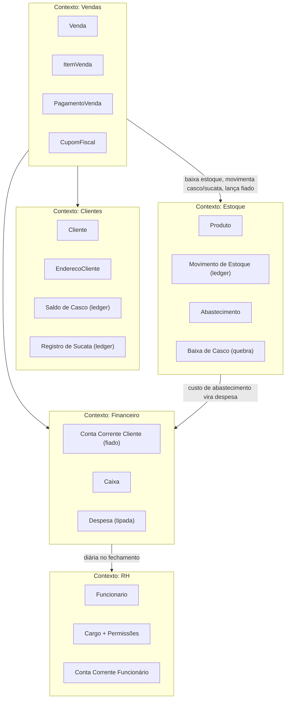

# ControleEstoque — Plano de Implementação

**Insumos:** `REGRAS_DE_NEGOCIO.md` (domínio) + `ARCHITECTURE_GUIDE.md` (padrões, adaptados de MEDRobot → ControleEstoque).
**Alvo:** .NET 10, Minimal API, raw Npgsql, PostgreSQL 16, xUnit.
**Público:** modelos executores (Opus/Sonnet) implementando sprint a sprint no Claude Code.

> **Leia a Seção 6 (Regras Críticas) antes de escrever qualquer linha de código de Vendas ou Cascos.**

---

## 1. Análise de Domínio (DDD)

### 1.1 Bounded Contexts



| Contexto | Entidades | Value Objects |
|---|---|---|
| **Clientes** | Cliente, EnderecoCliente; ledgers MovimentoCascoCliente, EntregaSucataCliente | Telefone, SaldoCasco (int), TotalSucataEntregue (int) |
| **Estoque** | Produto, Marca, MovimentoEstoque, Abastecimento (+itens), BaixaCasco (+responsáveis) | TipoProduto, Categoria (texto livre), Tamanho (texto livre), QuantidadeAssinada, PrecoReferencia, FotoUrl |
| **Vendas** | Venda (agregado raiz), ItemVenda, PagamentoVenda, CupomFiscal | Desconto(Tipo, Valor, Motivo), FormaPagamento, StatusPagamento |
| **Financeiro** | LancamentoFiado, Caixa, CaixaDespesa, TipoDespesa | TipoLancamentoFiado, SaldoFiado |
| **RH** | Funcionario, Cargo, CargoPermissao, LancamentoFuncionario | ValorDiaria, TipoLancamentoFuncionario, Permissao (string, ex: `vendas.registrar`) |

### 1.2 Fluxos críticos

1. **Venda de água com troca de casco** (4.1): venda → baixa estoque de água → EMPRESTIMO de casco (qtd vendida) → DEVOLUCAO de casco (qtd devolvida) → entrada de vazios no estoque → sucata entregue (registro à parte) → pagamentos N formas → diferença vira DEBITO_VENDA no fiado.
2. **Edição de venda** (4.13): recarrega agregado, **substitui** (soft delete + reinsere) itens/pagamentos/movimentos de casco/sucata vinculados à venda, recalcula totais e status — tudo em uma transação.
3. **Pagar casco** (4.6/4.8): devolução física (DEVOLUCAO + entrada estoque) OU conversão em valor (CONVERSAO_VALOR + DEBITO_CONVERSAO_CASCO no fiado).
4. **Entrega de sucata** (4.9): entrada estoque SUCATA + registro no cliente; opcionalmente CREDITO_CONVERSAO_SUCATA no fiado. **Nunca toca o saldo de casco.**
5. **Fechamento de caixa** (4.11): lança DIARIA por funcionário presente na conta corrente do funcionário; consolida entradas (pagamentos de venda + pagamentos de fiado em dinheiro/pix do dia), saídas (despesas tipadas) e saldo final; muda status para FECHADO.
6. **Baixa de casco por quebra** (4.7): `-N` no estoque CASCO, `+N` no estoque SUCATA, responsáveis registrados.

### 1.3 Invariantes de negócio

- Venda de água só empresta **casco normal**; sucata jamais gera EMPRESTIMO.
- Entrega de sucata **não** abate saldo de casco normal.
- `status_pagamento = PAGA` ⟺ `SUM(pagamentos) ≥ total_liquido`.
- Desconto sempre acompanhado de motivo (constraint no banco + validação de domínio).
- Diária nunca sai do caixa como pagamento direto — sempre credita a conta corrente do funcionário.
- Fiado só recebe lançamento em 3 situações: venda não totalmente paga, conversão de casco em valor, conversão de sucata em crédito.
- Saldos (estoque, casco, sucata, fiado, funcionário) são **derivados dos ledgers** — nunca atualizados como contador solto.
- Cargo ADM é nativo: não editável, não removível.

---

## 2. Banco de Dados

Schema completo em **`infra/postgres/init.sql`** (pronto para `psql -f`). Decisões de modelagem:

- **Ledger-first**: `movimentos_estoque`, `movimentos_casco_cliente`, `entregas_sucata_cliente`, `lancamentos_fiado`, `lancamentos_funcionario` são a fonte de verdade; saldos vêm das views `vw_estoque_atual`, `vw_saldo_casco_cliente`, `vw_sucata_entregue_cliente`, `vw_saldo_fiado_cliente`, `vw_saldo_funcionario`. Isso torna a edição de venda segura: apaga (soft) e reinsere os movimentos da venda, e os saldos se corrigem sozinhos.
- **Casco e sucata são `produtos`** (`tipo = CASCO` / `SUCATA`), então participam do estoque com o mesmo mecanismo dos demais.
- **`tipo_produto` define comportamento, não natureza**: qualquer produto novo sem regra de casco (carvão, gelo, copos…) é cadastrado como `DESCARTAVEL`, com agrupamento de exibição no campo livre `categoria`. Não se cria valor novo no ENUM para cada mercadoria.
- **Marca é entidade cadastrável** (`marcas`), referenciada por `produtos.marca_id` — obrigatória para AGUA/GALAO_COMPLETO (validação de domínio), opcional para o restante. `tamanho` é texto livre ('20L', '10L', '200ml', '5kg'…).
- **Foto do produto**: `produtos.foto_url` guarda o caminho; o arquivo em si vai para volume de arquivos servido pela API (banco não armazena binário).
- **Totais da venda desnormalizados** (`total_bruto/desconto/liquido`, `status_pagamento`) recalculados pelo serviço em toda escrita — nunca aceitos do cliente HTTP.
- **Endereços em tabela própria** (não JSONB): precisam de FK a partir da venda.
- **Soft delete universal** (`deleted_at`); toda query filtra `deleted_at IS NULL`.
- **Um caixa por dia** (`caixas.data UNIQUE`).
- Seeds: cargo ADM (permissão `*`), produtos estruturais Casco/Sucata, tipos de despesa básicos.

---

## 3. Arquitetura de Solução .NET 10

### 3.1 Estrutura de diretórios

```
controle-estoque-api/
├── src/
│   ├── shared/
│   │   ├── ControleEstoque.Shared.sln
│   │   ├── ControleEstoque.Shared.Hosting/      ← AddControleEstoqueApiDefaults, GlobalErrorHandlerMiddleware, CorrelationMiddleware
│   │   ├── ControleEstoque.Shared.Telemetry/    ← PlatformTelemetry (1 ActivitySource, 1 Meter), TelemetrySpanNames, TelemetryTagNames
│   │   ├── ControleEstoque.Shared.Results/      ← OperationResult<T>, ControlledFailureException + derivadas
│   │   └── ControleEstoque.Shared.Contracts/    ← ApiErrorEnvelope, CorrelationContext
│   ├── estoque/
│   │   ├── ControleEstoque.Estoque.sln
│   │   ├── ControleEstoque.Estoque.API/         ← Minimal API (Program.cs + MapEstoqueEndpoints)
│   │   ├── ControleEstoque.Estoque.Contracts/   ← records de request/response
│   │   ├── ControleEstoque.Estoque.Domain/      ← entidades, interfaces, validadores
│   │   ├── ControleEstoque.Estoque.Hosting/     ← ServiceCollectionExtensions
│   │   ├── ControleEstoque.Estoque.Repository/  ← Postgres*Repository (raw Npgsql)
│   │   └── ControleEstoque.Estoque.Tests/
│   ├── clientes/        ← idem padrão (Cliente, Endereço, SaldoCasco, RegistroSucata)
│   ├── vendas/          ← idem padrão (core do sistema)
│   ├── financeiro/      ← idem padrão (Fiado, Caixa, Despesas)
│   └── rh/              ← idem padrão (Funcionário, Cargo, ContaCorrente)
├── infra/
│   ├── docker-compose.yml       ← postgres:16-alpine + APIs
│   ├── postgres/init.sql        ← JÁ CRIADO neste repositório
│   └── .dockerignore
├── tools/smoke/                 ← smoke tests bash
└── docs/ARCHITECTURE.md
```

### 3.2 Decisões arquiteturais (obrigatórias, não renegociáveis)

| Aspecto | Decisão |
|---|---|
| ORM | **Raw ADO.NET + Npgsql** — proibido EF Core/Dapper |
| Persistência | `I<Nome>Repository` com `async Task<T>`, SQL em `private static class Sql` |
| HTTP | Minimal API; endpoints em extension `Map<Contexto>Endpoints()`, lambdas < 20 linhas delegando a serviços |
| gRPC | **Não usar no MVP** — só HTTP |
| Comunicação entre contextos | Banco único compartilhado. Cada contexto é dono lógico de suas tabelas; **exceção documentada**: o `VendaService` escreve transacionalmente em tabelas de Estoque/Clientes/Financeiro dentro de uma única `NpgsqlTransaction` (atomicidade > pureza de contexto no MVP). Nenhum project reference entre contextos — a exceção é só via SQL no repositório de Vendas |
| DI | Singleton para repositórios/serviços stateless; `NpgsqlDataSource` singleton |
| Validação | Inline no endpoint (formato) + validadores de domínio (`sealed class <Nome>Validator`) — sem FluentValidation |
| Logging | `Microsoft.Extensions.Logging`, JSON console, `IncludeScopes: true`, `BeginScope` com CorrelationId em todo entry point |
| Observabilidade | OpenTelemetry opcional (feature futura); spans/métricas via `PlatformTelemetry` desde já |
| Testes | xUnit; fakes concretos (`sealed class Fake<Nome>`) para serviços; TestContainers p/ repositórios; **não mockar repositório com Moq** |
| Secrets | `appsettings.json` com defaults + `appsettings.local.json` no `.gitignore` |
| Config | Seção raiz `ControleEstoque:` (ex.: `ControleEstoque:Vendas:ConnectionString`), Options com `SectionName` + `ValidateOnStart()` |

---

## 4. Especificação de APIs HTTP

Convenções globais: prefixo `/v1`; erros no envelope `ApiErrorEnvelope(Code, Message, TraceId)`; `400` = formato inválido, `404` = não encontrado, `422` = regra de negócio violada, `500` = erro técnico. Header `X-Correlation-Id` aceito e ecoado.

### 4.1 Vendas (porta 5101)

```
POST /v1/vendas
├── Request: CreateVendaRequest {
│     ClienteId, FuncionarioId, EnderecoEntregaId?,
│     Itens[]: { ProdutoId, Quantidade, PrecoUnitario, Desconto?: { Tipo: "VALOR"|"PERCENTUAL", Valor, Motivo } },
│     Pagamentos[]: { Forma: "PIX"|"CARTAO_CREDITO"|"CARTAO_DEBITO"|"DINHEIRO"|"OUTRO", Valor },
│     CascosDevolvidos: int (>=0),           ← devolução de casco NORMAL no ato
│     CascosDevolvidosNaHora: bool,          ← atalho: devolvidos = qtd de água vendida
│     SucataEntregue: int (>=0),             ← registro à parte; NÃO abate casco
│     Observacao? }
├── Response 201: VendaResponse { Id, Data, TotalBruto, TotalDesconto, TotalLiquido,
│     TotalPago, SaldoFiadoGerado, StatusPagamento, SaldoCascoCliente, Itens[], Pagamentos[] }
├── Validação 400: itens não vazios, quantidades > 0, preços >= 0, desconto ⇒ motivo,
│     valores de pagamento > 0, SUM(pagamentos) <= total líquido
├── Validação 422: cliente/funcionário/produto existem e não deletados;
│     estoque suficiente por produto; endereço pertence ao cliente
├── Efeitos (UMA transação):
│     1. INSERT vendas + venda_itens (total_item calculado pelo serviço)
│     2. movimentos_estoque: SAIDA_VENDA (-qtd) por item
│     3. item de AGUA ⇒ movimentos_casco_cliente EMPRESTIMO (qtd de água)
│     4. CascosDevolvidos > 0 ⇒ DEVOLUCAO + movimentos_estoque DEVOLUCAO_CLIENTE (+qtd no produto CASCO)
│     5. SucataEntregue > 0 ⇒ entregas_sucata_cliente + movimentos_estoque ENTRADA_SUCATA
│     6. INSERT venda_pagamentos
│     7. faltante = total_liquido − SUM(pagamentos); se > 0 ⇒ lancamentos_fiado DEBITO_VENDA
│     8. status_pagamento: PAGA | PARCIAL | PENDENTE
└── Errors: 400, 404 (cliente/produto), 422 (estoque insuficiente: "ESTOQUE_INSUFICIENTE"), 500
```

```
PUT /v1/vendas/{id}
├── Request: UpdateVendaRequest — mesmo shape do Create
├── Response 200: VendaResponse
├── Lógica: transação que soft-deleta itens, pagamentos, movimentos de estoque/casco,
│     entregas de sucata e lançamento DEBITO_VENDA vinculados à venda, e reinsere
│     conforme o request (replay). Views de saldo se autocorrigem.
├── Validação 422: venda existe e não deletada; VENDA_JA_FATURADA se cupom emitido
│     (edição pós-cupom bloqueada — decisão MVP)
└── Errors: 400, 404, 422, 500
```

```
GET /v1/vendas/{id}                → 200 VendaResponse | 404
GET /v1/vendas?clienteId&inicio&fim&page&pageSize → 200 lista paginada
POST /v1/vendas/{id}/pagamentos    → adiciona pagamento pós-venda
├── Request: { Forma, Valor }
├── Efeitos: INSERT venda_pagamentos; recalcula status; se cobriu o faltante,
│     lança PAGAMENTO no fiado abatendo o DEBITO_VENDA correspondente
└── 200 VendaResponse | 422 (PAGAMENTO_EXCEDE_SALDO)
POST /v1/vendas/{id}/cupom-fiscal
├── Response 201: { CupomId, Numero, EmitidoEm } — MVP: gera número sequencial e
│     persiste em cupons_fiscais (payload JSONB); integração SEFAZ é feature futura
└── 409 se já emitido | 404 | 422 (venda deletada)
```

### 4.2 Clientes (porta 5102)

```
POST /v1/clientes                  → 201 { Id } | 400
PUT  /v1/clientes/{id}             → 200 | 404
GET  /v1/clientes/{id}             → 200 ClienteResponse (com endereços) | 404
GET  /v1/clientes?nome&page        → 200 lista paginada
POST /v1/clientes/{id}/enderecos   → 201 | 404
GET  /v1/clientes/{id}/saldos
└── 200 { SaldoCascos: int, SucataEntregue: int, SaldoFiado: decimal }
     (uma query nas 3 views)

POST /v1/clientes/{id}/cascos/devolucoes        ← Pagar Casco (devolução física avulsa)
├── Request: { Quantidade > 0 }
├── Efeitos: movimentos_casco_cliente DEVOLUCAO + movimentos_estoque DEVOLUCAO_CLIENTE
└── 200 { NovoSaldoCascos } | 404 | 400

POST /v1/clientes/{id}/cascos/conversoes        ← Pagar Casco (conversão em valor)
├── Request: { Quantidade > 0, ValorUnitario > 0 }
├── Validação 422: Quantidade <= saldo de cascos do cliente (CONVERSAO_MAIOR_QUE_SALDO)
├── Efeitos: CONVERSAO_VALOR no ledger de casco + DEBITO_CONVERSAO_CASCO no fiado
│     (obs.: NÃO dá entrada no estoque físico — o casco continua com o cliente, agora comprado)
└── 200 { NovoSaldoCascos, NovoSaldoFiado }

POST /v1/clientes/{id}/sucatas                  ← Entrega de Sucata avulsa
├── Request: { Quantidade > 0, ValorConversao?: decimal }
├── Efeitos: entregas_sucata_cliente + movimentos_estoque ENTRADA_SUCATA;
│     se ValorConversao ⇒ CREDITO_CONVERSAO_SUCATA no fiado
└── 200 { TotalSucataEntregue, NovoSaldoFiado? }   ← saldo de CASCO não muda
```

### 4.3 Estoque (porta 5103)

```
POST /v1/marcas                    → { Nome } → 201 | 409 (nome duplicado)
GET  /v1/marcas                    → 200
POST /v1/produtos
├── Request: { Tipo, Nome, MarcaId?, Categoria?, Tamanho?, PrecoReferencia, EstoqueMinimo }
├── Validação 400: MarcaId obrigatório se Tipo = AGUA ou GALAO_COMPLETO (MARCA_OBRIGATORIA);
│     produto sem regra de casco (carvão, gelo etc.) entra como Tipo = DESCARTAVEL
└── 201 | 422 (marca inexistente)
PUT  /v1/produtos/{id}             → 200 | 404
GET  /v1/produtos?tipo&marcaId&categoria → 200
POST /v1/produtos/{id}/foto        ← multipart/form-data (jpg/png, máx. 5MB)
├── Efeitos: salva arquivo no volume de mídia, atualiza produtos.foto_url
└── 200 { FotoUrl } | 400 (formato/tamanho) | 404
GET  /v1/produtos/{id}/foto        → 200 (arquivo) | 404
GET  /v1/estoque                   → 200 [ vw_estoque_atual ] (inclui AbaixoMinimo)
POST /v1/estoque/movimentos        ← ajuste manual (AJUSTE, qtd assinada) → 201 | 422
POST /v1/abastecimentos
├── Request: { TipoFrete, CustoTotal, FuncionarioId?, Itens[]: { ProdutoId, Quantidade, CustoUnitario } }
├── Efeitos: abastecimentos + itens + ENTRADA_ABASTECIMENTO por item;
│     se caixa do dia aberto, INSERT caixa_despesas (tipo "Abastecimento")
└── 201 | 422 (CAIXA_NAO_ABERTO é warning, não erro — despesa fica pendente de lançamento manual)
POST /v1/estoque/cascos/baixas     ← quebra
├── Request: { Quantidade > 0, Motivo?, ResponsaveisIds[]: uuid (>=1) }
├── Efeitos: baixas_casco + responsáveis + BAIXA_QUEBRA (−qtd CASCO) + ENTRADA_SUCATA (+qtd SUCATA)
└── 201 | 422 (ESTOQUE_INSUFICIENTE) | 400 (sem responsáveis)
```

### 4.4 Financeiro (porta 5104)

```
POST /v1/caixas                    ← abre o caixa do dia { Data?, SaldoInicial } → 201 | 409 (já existe)
GET  /v1/caixas/{data}             → 200 { resumo: entradas, despesas, diárias, saldo parcial } | 404
POST /v1/caixas/{id}/despesas      → { TipoDespesaId, Valor, Descricao? } → 201 | 422 (CAIXA_FECHADO)
POST /v1/caixas/{id}/fechamento
├── Request: { Diarias[]: { FuncionarioId } }   ← quem trabalhou; falta = não listar
├── Efeitos: p/ cada funcionário, DIARIA (valor_diaria do cadastro) em lancamentos_funcionario;
│     consolida total_entradas/total_saidas/saldo_final; status = FECHADO
└── 200 CaixaFechadoResponse | 422 (CAIXA_JA_FECHADO)
GET  /v1/tipos-despesa             → 200 | POST /v1/tipos-despesa → 201

POST /v1/clientes/{id}/fiado/pagamentos   ← baixa de dívida antiga
├── Request: { Valor > 0, Forma }
├── Validação 422: Valor <= saldo devedor (PAGAMENTO_EXCEDE_SALDO)
├── Efeitos: PAGAMENTO em lancamentos_fiado (+entrada no caixa do dia se aberto)
└── 200 { NovoSaldoFiado }
```

### 4.5 RH (porta 5105)

```
POST /v1/cargos                    → 201 | 400; PUT/DELETE bloqueados p/ nativo=TRUE → 422 (CARGO_NATIVO)
POST /v1/funcionarios              → 201 { Id }
PUT  /v1/funcionarios/{id}         → 200
GET  /v1/funcionarios/{id}/conta-corrente → 200 { SaldoAPagar, Lancamentos[] }
POST /v1/funcionarios/{id}/vales   → { Valor > 0 } → 201 (VALE no ledger)
POST /v1/funcionarios/{id}/pagamentos → { Valor > 0 } → 201 | 422 (PAGAMENTO_EXCEDE_SALDO)
```

### 4.6 Relatórios (na API do contexto dono dos dados)

```
GET /v1/relatorios/faturamento?inicio&fim&produtoId?     (Vendas)
└── 200 { TotalBruto, TotalDesconto, TotalLiquido, PorProduto[], PorDia[] }
GET /v1/relatorios/vendas-por-funcionario?inicio&fim     (Vendas)
GET /v1/relatorios/estoque                               (Estoque — vw_estoque_atual + alertas)
GET /v1/relatorios/caixa?inicio&fim                      (Financeiro — inclui despesas por tipo e diárias)
GET /v1/relatorios/fiado                                 (Financeiro — vw_saldo_fiado_cliente, saldo > 0)
GET /v1/relatorios/cascos                                (Clientes — vw_saldo_casco_cliente, saldo <> 0)
GET /v1/relatorios/sucata                                (Clientes — vw_sucata_entregue_cliente)
GET /v1/relatorios/conta-funcionarios                    (RH — vw_saldo_funcionario)
```

Exemplo de request/response (venda):

```json
POST /v1/vendas
{
  "clienteId": "3f1c…", "funcionarioId": "9ab2…",
  "itens": [
    { "produtoId": "agua-marca-a…", "quantidade": 5, "precoUnitario": 50.00 }
  ],
  "pagamentos": [ { "forma": "PIX", "valor": 200.00 } ],
  "cascosDevolvidos": 3,
  "cascosDevolvidosNaHora": false,
  "sucataEntregue": 1
}

201 Created
{
  "id": "b7e4…", "totalBruto": 250.00, "totalDesconto": 0.00, "totalLiquido": 250.00,
  "totalPago": 200.00, "saldoFiadoGerado": 50.00, "statusPagamento": "PARCIAL",
  "saldoCascoCliente": 2
}
```

---

## 5. Sequência de Implementação (Sprints)

Cada sprint termina com `dotnet build` + `dotnet test` verdes e smoke test passando. Não iniciar sprint N+1 com pendências na N.

### Sprint 1 — Infraestrutura
- [ ] Criar repo `controle-estoque-api/` com `.gitignore` (.NET + `appsettings.local.json`), `.editorconfig` (`TreatWarningsAsErrors`, `Nullable=enable`, net10.0)
- [ ] `infra/docker-compose.yml`: `postgres:16-alpine`, volume, `infra/postgres/init.sql` montado em `/docker-entrypoint-initdb.d/`
- [ ] Copiar `init.sql` deste repositório para `infra/postgres/init.sql` e validar com `docker compose up` + `psql -c "\dt"`
- [ ] `shared/`: Results (`OperationResult<T>`, `ControlledFailureException(Code, StatusCode)` + `EntityNotFoundException`, `BusinessRuleException`, `InsufficientStockException`), Contracts (`ApiErrorEnvelope`), Telemetry (`PlatformTelemetry` com 1 ActivitySource/Meter `"ControleEstoque.Platform"`), Hosting (`AddControleEstoqueApiDefaults` = health check `/health` + logging JSON + options; `GlobalErrorHandlerMiddleware`; `CorrelationMiddleware`)
- [ ] Template de `Program.cs` conforme Seção 7.3 do guia + `public partial class Program;`
- **Critério de aceite:** API vazia de exemplo sobe, `/health` responde `Healthy`, erro lançado vira `ApiErrorEnvelope` com TraceId.

### Sprint 2 — Estoque
- [ ] Domain: `Produto`, `Marca`, `MovimentoEstoque`, `Abastecimento`, `BaixaCasco`; `IProdutoRepository`, `IMarcaRepository`, `IEstoqueRepository`, `IAbastecimentoRepository`; `ProdutoValidator` (marca obrigatória p/ AGUA/GALAO_COMPLETO; tamanho/categoria livres)
- [ ] Repository: `PostgresProdutoRepository`, `PostgresMarcaRepository`, `PostgresEstoqueRepository` (saldo via `vw_estoque_atual`; inserts no ledger), `PostgresAbastecimentoRepository` (transação abastecimento + itens + movimentos)
- [ ] API: endpoints da Seção 4.3, incluindo CRUD de marcas e upload/download de foto do produto (`FotoStorageService` gravando em volume local configurável via `ControleEstoque:Estoque:MediaPath`)
- [ ] `BaixaCascoService`: valida estoque de CASCO ≥ quantidade, grava baixa + responsáveis + os dois movimentos (−CASCO/+SUCATA) na mesma transação
- [ ] Testes: unitários de validadores/serviços com fakes; integração de repositórios com TestContainers
- **Critério de aceite:** abastecer, consultar estoque, baixar casco quebrado; saldo bate com os movimentos.

### Sprint 3 — Clientes
- [ ] Domain: `Cliente`, `EnderecoCliente`; ledgers `MovimentoCascoCliente`, `EntregaSucataCliente`; `ICascoLedgerRepository`, `ISucataLedgerRepository`
- [ ] Repository + API: CRUD cliente/endereços, `GET /saldos` (3 views), devolução avulsa, conversão de casco, entrega de sucata (Seção 4.2)
- [ ] Testes cobrindo: devolução gera crédito quando excede débito; conversão limitada ao saldo; **entrega de sucata não altera saldo de casco** (teste obrigatório)
- **Critério de aceite:** os três saldos do cliente respondem corretamente após sequência mista de operações.

### Sprint 4 — Vendas (core do sistema)
- [ ] Domain: agregado `Venda` com método `Recalcular()` (totais por item com desconto VALOR/PERCENTUAL, status de pagamento); `DescontoValidator` (motivo obrigatório); `IVendaRepository`
- [ ] `VendaService.CriarAsync` implementando os 8 efeitos da Seção 4.1 em **uma** `NpgsqlTransaction`
- [ ] `VendaService.EditarAsync` com estratégia de replay (soft delete + reinserção dos registros vinculados)
- [ ] Pagamento pós-venda, cupom fiscal (número sequencial + JSONB), consultas paginadas
- [ ] Testes de cenário (mínimo): venda paga integral; parcial gera fiado; múltiplas formas; desconto por item recalcula total; água gera EMPRESTIMO e galão completo NÃO; `cascosDevolvidosNaHora=true` iguala devolvidos a vendidos; devolução > vendida gera crédito; sucata junto não abate casco; edição substitui efeitos sem duplicar saldo; estoque insuficiente → 422; edição pós-cupom → 422
- **Critério de aceite:** walkthrough da Seção 7 reproduzível de ponta a ponta via HTTP.

### Sprint 5 — Financeiro
- [ ] Domain/Repository/API: `Caixa` (abrir/despesas/fechamento), `TipoDespesa`, `LancamentoFiado` (pagamento de dívida)
- [ ] `FechamentoCaixaService`: diárias → `lancamentos_funcionario`; consolidação de entradas (venda_pagamentos do dia + pagamentos de fiado) e saídas (despesas)
- [ ] Testes: fechamento idempotente-negado (422 na 2ª vez); diária usa `valor_diaria` do cadastro; pagamento de fiado não excede saldo
- **Critério de aceite:** dia completo simulado (abrir → vender → despesa → fechar) com saldo final correto.

### Sprint 6 — RH
- [ ] Domain/Repository/API: `Funcionario`, `Cargo` + permissões (ADM protegido), conta corrente (vale/pagamento/extrato)
- [ ] Testes: saldo = diárias − vales − pagamentos; cargo nativo bloqueado p/ edição
- **Critério de aceite:** ciclo diária→vale→pagamento semanal fecha o saldo.

### Sprint 7 — Relatórios
- [ ] Endpoints da Seção 4.6, todos com filtros de período onde aplicável, resposta JSON
- [ ] Faturamento: agrupamento por produto e por dia; excluir vendas deletadas
- [ ] Testes de integração com dados semeados
- **Critério de aceite:** relatório de faturamento por período e/ou produto confere com as vendas inseridas.

### Sprint 8 — Qualidade
- [ ] Testes de integração `WebApplicationFactory` por API (fluxo feliz + 1 erro controlado cada)
- [ ] `tools/smoke/controle-estoque-smoke.sh`: health de todas as APIs + venda e2e + consulta de saldos
- [ ] Dockerfiles multi-stage por API; compose completo
- [ ] `README.md`: setup local em ≤ 5 comandos
- [ ] `[Collection("Integration")]` nos testes que compartilham factory
- **Critério de aceite:** `docker compose up` + smoke script verde do zero.

---

## 6. Regras Críticas de Implementação

**As 7 regras que modelos executores mais erram. Em dúvida, esta seção vence qualquer interpretação.**

1. **Casco normal ≠ sucata — e sucata nunca é emprestada.** Venda de água empresta APENAS casco normal (`movimentos_casco_cliente`). Sucata só existe como entrega do cliente ou baixa por quebra (`entregas_sucata_cliente`). Devolver sucata **não** abate débito de casco. São ledgers, saldos e estoques distintos. *Erro típico: tratar sucata como "tipo de casco" no mesmo ledger.*

2. **Fiado é conta financeira, não contagem de casco.** Só 3 eventos lançam fiado: (a) venda não 100% paga → `DEBITO_VENDA`; (b) conversão de débito de casco em valor → `DEBITO_CONVERSAO_CASCO`; (c) conversão de sucata entregue → `CREDITO_CONVERSAO_SUCATA`. `saldo_cascos = 5` NÃO significa dívida em reais. *Erro típico: lançar valor no fiado quando o cliente leva casco emprestado.*

3. **Venda é agregado editável com replay.** N itens, N pagamentos, desconto por item com motivo obrigatório, devolução de casco e entrega de sucata como campos independentes. Edição = soft delete de TODOS os efeitos vinculados à venda (itens, pagamentos, movimentos de estoque, movimentos de casco, entregas de sucata, débito de fiado) + reinserção, em uma transação. *Erro típico: editar só `venda_itens` e deixar movimentos órfãos duplicando saldos.*

4. **Preço não é tabela fixa.** `preco_referencia` é sugestão de tela; o preço efetivo vem no request de cada item. Nunca recusar venda por preço ≠ referência; nunca buscar preço do banco na hora de calcular o total.

5. **Estoque de casco tem tripla contabilidade.** (a) estoque físico de CASCO vazio (ledger de estoque); (b) estoque físico de SUCATA; (c) saldo de casco por cliente (ledger próprio). Venda de água: −água no estoque, +EMPRESTIMO no cliente; devolução: +CASCO no estoque, +DEVOLUCAO no cliente; quebra: −CASCO, +SUCATA, sem tocar cliente; conversão em valor: só cliente+fiado, **sem** entrada de estoque. *Erro típico: dar entrada no estoque físico na conversão em valor.*

6. **Endereço é múltiplo e por venda.** Cliente tem N endereços; a venda referencia um deles (`endereco_entrega_id`, validado como pertencente ao cliente). Sem rota, sem status de entrega.

7. **Caixa não paga diária.** Fechamento credita `DIARIA` na conta corrente do funcionário (valor do cadastro); pagamento real é evento posterior (`PAGAMENTO`), normalmente semanal. Vale é `VALE` (débito). Falta = simplesmente não listar o funcionário no fechamento. *Erro típico: lançar diária como despesa de caixa em dinheiro no dia.*

---

## 7. Walkthrough — Venda de Água com Troca de Casco (caso 4.1)

**Cenário:** Cliente X compra 5 galões de água (marca A) a R$ 50,00; devolve 3 cascos vazios; entrega 1 sucata; paga R$ 200 em pix. Saldo de casco anterior: 0. Estoque anterior: água A = 20, casco vazio = 10, sucata = 2.

### 7.1 Request

```json
POST /v1/vendas
{ "clienteId": "CLI-X", "funcionarioId": "FUNC-1",
  "itens": [ { "produtoId": "AGUA-A", "quantidade": 5, "precoUnitario": 50.00 } ],
  "pagamentos": [ { "forma": "PIX", "valor": 200.00 } ],
  "cascosDevolvidos": 3, "cascosDevolvidosNaHora": false, "sucataEntregue": 1 }
```

### 7.2 SQL executado (uma transação)

```sql
BEGIN;

INSERT INTO vendas (id, cliente_id, funcionario_id, total_bruto, total_desconto,
                    total_liquido, status_pagamento, created_by)
VALUES ('VENDA-1', 'CLI-X', 'FUNC-1', 250.00, 0.00, 250.00, 'PARCIAL', 'FUNC-1');

INSERT INTO venda_itens (venda_id, produto_id, quantidade, preco_unitario, total_item)
VALUES ('VENDA-1', 'AGUA-A', 5, 50.00, 250.00);

-- estoque: sai a água
INSERT INTO movimentos_estoque (produto_id, tipo, quantidade, venda_id, created_by)
VALUES ('AGUA-A', 'SAIDA_VENDA', -5, 'VENDA-1', 'FUNC-1');

-- casco NORMAL: empresta 5, devolve 3
INSERT INTO movimentos_casco_cliente (cliente_id, venda_id, tipo, quantidade, created_by)
VALUES ('CLI-X', 'VENDA-1', 'EMPRESTIMO', 5, 'FUNC-1'),
       ('CLI-X', 'VENDA-1', 'DEVOLUCAO',  3, 'FUNC-1');

-- os 3 vazios devolvidos entram no estoque físico de casco
INSERT INTO movimentos_estoque (produto_id, tipo, quantidade, venda_id, created_by)
VALUES ('PROD-CASCO', 'DEVOLUCAO_CLIENTE', 3, 'VENDA-1', 'FUNC-1');

-- sucata: registro do cliente + estoque (NENHUM efeito no ledger de casco)
INSERT INTO entregas_sucata_cliente (cliente_id, venda_id, quantidade, created_by)
VALUES ('CLI-X', 'VENDA-1', 1, 'FUNC-1');
INSERT INTO movimentos_estoque (produto_id, tipo, quantidade, venda_id, created_by)
VALUES ('PROD-SUCATA', 'ENTRADA_SUCATA', 1, 'VENDA-1', 'FUNC-1');

INSERT INTO venda_pagamentos (venda_id, forma, valor, created_by)
VALUES ('VENDA-1', 'PIX', 200.00, 'FUNC-1');

-- faltante 50.00 vira fiado
INSERT INTO lancamentos_fiado (cliente_id, venda_id, tipo, valor, created_by)
VALUES ('CLI-X', 'VENDA-1', 'DEBITO_VENDA', 50.00, 'FUNC-1');

COMMIT;
```

### 7.3 Response

```json
201 Created
{ "id": "VENDA-1", "totalBruto": 250.00, "totalDesconto": 0.00, "totalLiquido": 250.00,
  "totalPago": 200.00, "saldoFiadoGerado": 50.00, "statusPagamento": "PARCIAL",
  "saldoCascoCliente": 2 }
```

### 7.4 Estado final no banco

| Consulta | Antes | Depois |
|---|---|---|
| `vw_estoque_atual` (Água A) | 20 | **15** |
| `vw_estoque_atual` (Casco vazio) | 10 | **13** |
| `vw_estoque_atual` (Sucata) | 2 | **3** |
| `vw_saldo_casco_cliente` (CLI-X) | 0 | **2** (5 emprestados − 3 devolvidos) |
| `vw_sucata_entregue_cliente` (CLI-X) | 0 | **1** (apenas registro) |
| `vw_saldo_fiado_cliente` (CLI-X) | 0.00 | **50.00** |

### 7.5 Casos de erro

| Cenário | Status | Code | Efeito |
|---|---|---|---|
| Estoque de Água A = 3 (< 5) | 422 | `ESTOQUE_INSUFICIENTE` | rollback total, nada persiste |
| `clienteId` inexistente/deletado | 404 | `CLIENTE_NAO_ENCONTRADO` | idem |
| Pagamentos somam 300 (> 250) | 400 | `PAGAMENTO_EXCEDE_TOTAL` | rejeitado antes da transação |
| Desconto sem motivo | 400 | `DESCONTO_SEM_MOTIVO` | idem |

---

## 8. Padrões de Código Obrigatórios

Convenções do ARCHITECTURE_GUIDE adaptadas (prefixo `MEDRobot` → `ControleEstoque`):

| Item | Padrão | Exemplo |
|---|---|---|
| Classes | `sealed` sempre (serviços, repos, validators, testes) | `public sealed class VendaService` |
| Interfaces | `I` + conceito, definidas no próprio módulo Domain | `IVendaRepository`, `ICascoLedgerRepository` |
| Options | `sealed` + `const string SectionName` + defaults + `ValidateOnStart()` | `public const string SectionName = "ControleEstoque:Vendas";` |
| DTOs | `sealed record` imutável em `*.Contracts` | `public sealed record CreateVendaRequest(...)` |
| CancellationToken | sempre último parâmetro, sempre propagado | `Task<Venda> CriarAsync(CreateVendaCommand cmd, CancellationToken cancellationToken)` |
| Repositório | só `async Task<T>`; SQL em `private static class Sql`; `await using` em connection/command/reader; nunca `IQueryable`/EF | ver template 19.6 do guia |
| DI | 1 `ServiceCollectionExtensions` por contexto no `*.Hosting`; método `Add<Contexto>Services(IConfiguration)`; Singleton p/ stateless | `services.AddSingleton<IVendaRepository, PostgresVendaRepository>();` |
| Logging | `BeginScope` com `CorrelationId` no entry point; templates PascalCase; Info=fluxo normal, Warning=falha controlada, Error=inesperado | `logger.LogInformation("Venda {VendaId} registrada para cliente {ClienteId}.", ...)` |
| Erros | domínio herda `ControlledFailureException(Code, StatusCode)`; wire = `ApiErrorEnvelope(Code, Message, TraceId)`; mapeamento no `GlobalErrorHandlerMiddleware` | `InsufficientStockException → ("ESTOQUE_INSUFICIENTE", 422)` |
| Namespace | `ControleEstoque.<Contexto>.<Modulo>` | `ControleEstoque.Vendas.Domain` |
| Campos | camelCase sem `_`, `this.` no construtor; guards `ArgumentNullException.ThrowIfNull` | seção 4.5 do guia |
| Program.cs | `AddControleEstoqueApiDefaults` → `Add<Contexto>Services` → middlewares → `Map*Endpoints()` → `public partial class Program;` | template 19.3 do guia |
| Testes | `<SubjectUnderTest>Tests` sealed; `<Method>_<Condition>_<ExpectedOutcome>`; fakes concretos (`private sealed class Fake<Nome>`) > Moq; factory methods estáticos privados (sem Builders); TestContainers p/ repositório; `IsPackable=false`, global using Xunit | `VendaServiceTests.CriarAsync_QuandoEstoqueInsuficiente_LancaInsufficientStock` |
| Telemetria | 1 `ActivitySource`/`Meter` (`"ControleEstoque.Platform"`); span names em constantes (`VendasSpanNames.RegistrarVenda`), nunca string inline | seção 10 do guia |
| Proibido | EF Core, Dapper, FluentValidation, NSubstitute/FakeItEasy, `ConfigureAwait(false)`, referência entre bounded contexts, domínio em `shared/`, herança para extensão | seção 17 do guia |

### Instrução de handoff para o modelo executor

> Implemente a Sprint N do `PLANO_IMPLEMENTACAO.md`. Use o schema de `infra/postgres/init.sql` como está (não altere tabelas sem atualizar o plano). Siga os padrões da Seção 8 e as regras da Seção 6 — em conflito entre seu julgamento e a Seção 6, a Seção 6 vence. Ao final: `dotnet build` e `dotnet test` verdes, e o critério de aceite da sprint demonstrado via HTTP.
